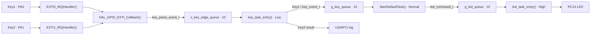
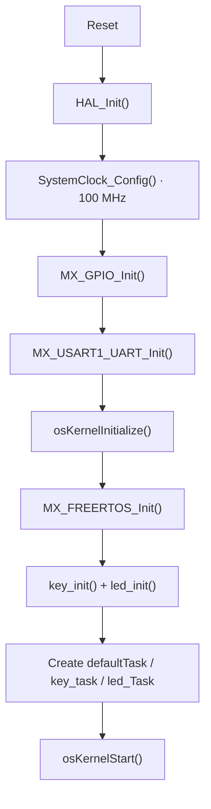

**English** | [简体中文](README_zh.md)

[](LICENSE)

# STM32F411 FreeRTOS Interrupt-Driven Key Control for LED

A complete embedded example for the STM32F411CEU6. GPIO external interrupts capture the press and release edges of two keys, FreeRTOS tasks perform debounce and short/long-press recognition, and message queues decouple key events from LED commands.

The project demonstrates the essential path from product requirements to flashable firmware, with an emphasis on separating interrupt and task responsibilities, independent per-key state machines, queue-based communication, boundary handling, and hardware acceptance testing.

## Table of Contents

- [Features](#features)
- [Design Highlights](#design-highlights)
- [Key Timing Definition](#key-timing-definition)
- [Hardware and Software Environment](#hardware-and-software-environment)
- [Quick Start](#quick-start)
- [System Architecture](#system-architecture)
- [Detailed Design](#detailed-design)
- [Project Structure](#project-structure)
- [Configuration](#configuration)
- [Testing and Acceptance](#testing-and-acceptance)
- [Runtime Constraints](#runtime-constraints)
- [Troubleshooting](#troubleshooting)
- [License](#license)

## Features

| Input | Recognition result | Product behavior |
|---|---|---|
| Key1 short press | `KEY_EVENT_SHORT_PRESS` | Toggle the PC13 LED once |
| Key1 long press | `KEY_EVENT_LONG_PRESS` | Blink the PC13 LED three times at 2 Hz, then restore its original state |
| Key2 short press | `KEY_EVENT_SHORT_PRESS` | Print the Key2 short-press log through USART1; leave the LED unchanged |
| Key2 long press | `KEY_EVENT_LONG_PRESS` | Print the Key2 long-press log through USART1; leave the LED unchanged |
| Debounce interval or timeout on either key | `KEY_EVENT_NONE` | Produce no product response |

Implementation features:

- Key1 and Key2 use EXTI0 and EXTI1 respectively, initially configured for falling-edge triggers.
- The interrupt callback captures only the key ID, edge, and timestamp; product behavior never runs in interrupt context.
- Each key maintains an independent state machine for its own press and release sequence.
- Three FreeRTOS queues connect interrupt capture, key recognition, event translation, and LED execution.
- All three application tasks block while waiting for messages, so no task polls the keys while idle.
- The LED is active-low and is initialized to the on state at power-up.

## Design Highlights

The main value of this project is not merely “using a key to control an LED.” It is the embedded architecture: C is used with object-oriented design principles to provide clear responsibilities, low coupling, and straightforward extensibility. “Object-oriented” here does not mean introducing C++ classes. Instead, structures, enumerations, module-private data, and explicit APIs organize hardware, state, events, and behavior as decoupled objects and interfaces.

### Object-Oriented Design in C

A key is split into two dimensions: its hardware description and its runtime instance.

- `key_hardware_t` describes the GPIO port and pin and therefore only answers where a key is connected.
- `key_runtime_t` stores the state machine, press Tick, release Tick, and hold duration and therefore only describes the current state of a key.
- `key_id_t` gives every key a stable logical identity so business logic does not depend directly on physical pins.
- `key_runtime[KEY_ID_COUNT]` creates one independent runtime instance per key, preventing Key1 and Key2 from contaminating each other's state.
- `key_hardware[KEY_ID_COUNT]` provides a table-driven mapping from logical keys to physical GPIOs.

This separation lets one recognition algorithm serve multiple physical keys without duplicating debounce and long-press logic for Key1 and Key2.

### Layered Decoupling

| Layer | Code entity | Single responsibility | What it does not need to know |
|---|---|---|---|
| Hardware capture | `HAL_GPIO_EXTI_Callback()` | Capture the key, edge, and timestamp | Short/long-press policy or LED behavior |
| Input recognition | `key_task_entry()` | Run state machines and generate key events | LED pin or blink implementation |
| Business mapping | `StartDefaultTask()` | Convert Key1 events into LED commands | EXTI details or active GPIO level |
| Device execution | `led_task_entry()` | Execute typed LED commands | Which key produced a command |

The layers exchange only `key_press_event_t`, `key_event_t`, and `led_command_t`; they do not share temporary control variables. This event-driven design reduces module coupling and allows the input device, business policy, and output device to be replaced or extended independently.

### Typed Interfaces and Explicit Error Semantics

The project does not use unrelated integers for states and commands. Each important concept has its own type:

- `key_trigger_edge_t`: press or release edge.
- `key_fsm_state_t`: key state-machine state.
- `key_event_t`: no event, short press, or long press.
- `led_state_t`: LED on, off, or toggle.
- `led_command_t`: no command, toggle, or blink three times.
- `led_operate_result_t` and `led_process_result_t`: separate low-level operation results from command-processing results.

Initialization APIs return `BaseType_t` success or failure values, while LED APIs use dedicated result enumerations. Callers check queue creation, message transmission, and command execution and emit module-tagged logs on error paths. If `key_init()` creates only part of its resources, it deletes any successfully created queue and clears both handles instead of leaving the module partially initialized.

### Encapsulation and Defensive Design

- The raw-edge queue, `s_key_edge_queue`, is declared `static` and remains private to the key module. External code can consume only the classified results on `g_key_queue`.
- A key ID is checked against `KEY_ID_COUNT` before it is used as an array index.
- The state machine contains a `default` recovery path that resets only the affected key instance after an invalid state.
- An unexpected repeated falling edge cannot corrupt the other key; it is logged and the current instance is reset.
- Active-low GPIO details are encapsulated by `led_operate()`, while higher layers use only `LED_STATE_ON/OFF/TOGGLE`.
- Task attributes, hardware mapping tables, and read-only configuration use `const` to express ownership and mutability.

### Comments and API Documentation

The core BSP files use consistent file headers and Doxygen-style API comments that document:

- Module responsibility, processing flow, dependencies, version, and maintainer.
- Function `@brief`, input parameters, return values, error meaning, and calling context.
- The boundary between ISR-safe APIs and task-context APIs.
- Queue initialization prerequisites, queue capacity, and the non-returning semantics of task entry functions.
- The business meaning of enumeration members and structure fields.

As a result, a caller can understand the module contract from the header before entering the `.c` file for implementation details, which follows the normal reading order of a maintainable driver module.

### Key Design for Future Extension

`KEY_ID_COUNT` serves as both the number of keys and the array boundary. A Key3 can be added while retaining the existing architecture:

1. Add `KEY_ID_3` to `key_id_t` and keep `KEY_ID_COUNT` as the last member.
2. Add the GPIO, EXTI, and NVIC configuration for Key3.
3. Add one physical mapping to `key_hardware[]` in enumeration order.
4. `key_runtime[KEY_ID_COUNT]` grows with the count and provides Key3 with an independent state instance.
5. Select a routing policy for the result: enqueue it, log it, or map it to a new business event.

The recognition algorithm, debounce boundary, and long-press classification do not need to be copied. Similarly, a new LED behavior only requires extending `led_command_t`, the business mapping, and `led_process_command()`; the key capture layer remains unchanged.

## Key Timing Definition

The hold duration is calculated with an unsigned Tick difference:

```text
Δt = release_tick - press_tick
```

Both `press_tick` and `release_tick` are captured by `HAL_GetTick()` in the GPIO EXTI callback. The current HAL time base is 1 ms.

| Hold duration Δt | Classification | Boundary behavior |
|---:|---|---|
| `Δt < 10 ms` | Debounce / invalid | 10 ms is not in this interval |
| `10 ms ≤ Δt < 1000 ms` | Short press | Includes 10 ms, excludes 1000 ms |
| `1000 ms ≤ Δt ≤ 5000 ms` | Long press | Includes both 1000 ms and 5000 ms |
| `Δt > 5000 ms` | Timeout / invalid | 5001 ms and above produce no valid event |

> [!NOTE]
> Short and long presses are classified only after release. Reaching 1000 ms while the key remains held does not immediately report a long press; the complete duration is classified when the key is released.

For the long-press LED action, the LED toggles once every 250 ms for a total of six toggles:

```text
Half-period = 250 ms
Period T    = 500 ms
Frequency f = 2 Hz
Total       = 3 complete periods
```

An even number of toggles ensures that the LED returns to the state it had before the command.

## Hardware and Software Environment

### Hardware

- STM32F411CEU6 development board (the example targets the WeAct STM32F411CEU6; an equivalent board with the same pin mapping can also be adapted)
- Two active-low keys
- Active-low LED on PC13
- ST-Link or compatible SWD debugger
- 3.3 V USB-to-UART adapter for viewing USART1 logs

### Pin Assignment

| Function | MCU pin | Configuration | External connection |
|---|---|---|---|
| Key1 | PA0 / EXTI0 | Pull-up input, low when pressed | Connect the other side of the key to GND |
| Key2 | PA1 / EXTI1 | Pull-up input, low when pressed | Connect the other side of the key to GND |
| LED | PC13 | Push-pull output, active-low | On-board LED or equivalent external circuit |
| USART1 TX | PA9 | Alternate-function push-pull output | Connect to the RX pin of the USB-to-UART adapter |
| USART1 RX | PA10 | Asynchronous serial input | Optional; connect to the adapter TX pin |
| SWDIO | PA13 | Debug interface | Connect to debugger SWDIO |
| SWCLK | PA14 | Debug interface | Connect to debugger SWCLK |

> [!IMPORTANT]
> The MCU and USB-to-UART adapter must share a ground and use 3.3 V logic levels. Both keys must remain high while idle and be pulled low when pressed.

### Toolchain

The repository contains the STM32 HAL, CMSIS, FreeRTOS kernel, and Keil project files; these sources do not need to be downloaded separately.

| Component | Project configuration or verified version |
|---|---|
| MCU | STM32F411CEU6, Cortex-M4F, 100 MHz |
| IDE / toolchain | Keil MDK-ARM 5; the project log uses ARM Compiler 5.06 update 7 |
| Device Family Pack | Keil STM32F4xx DFP 2.17.1 |
| STM32Cube firmware package | STM32Cube FW_F4 V1.28.3 |
| RTOS | FreeRTOS Kernel V10.3.1 + CMSIS-RTOS2 |
| Configuration tool | STM32CubeMX, optional and required only when editing the `.ioc` file |

## Quick Start

### 1. Connect the Hardware

Connect Key1, Key2, UART, and the SWD debugger according to the [pin assignment](#pin-assignment). If the board already has an LED on PC13, it can be used directly. Otherwise, connect an external LED driver circuit that follows the active-low behavior.

### 2. Open and Build the Project

1. Open `MDK-ARM/STM32F411CEU6.uvprojx` in Keil µVision.
2. Confirm that the target is `STM32F411CEU6` and that the STM32F4xx Device Family Pack is installed.
3. Run **Rebuild all target files**.
4. After a successful build, the project is configured to generate AXF and HEX files under `MDK-ARM/STM32F411CEU6/`.

### 3. Flash and Run

1. Connect the target through ST-Link or a compatible debugger.
2. Run **Download** in Keil.
3. Reset or power-cycle the target. The keys can be tested after the FreeRTOS scheduler starts.

### 4. Open the Serial Log

Use these serial settings:

```text
USART1
115200 baud
8 data bits
1 stop bit
No parity
No flow control
```

Expected Key2 recognition logs:

```text
[I][KEY] Key2 short press.
[I][KEY] Key2 long press.
```

Key1 controls the LED. The current debug output also prints this line after every successful LED toggle:

```text
TEST_LOG:LED toggle successfully.
```

## System Architecture

### Data Flow



This message path separates hardware capture, input recognition, business mapping, and output execution into four layers. The key module does not operate the LED directly, and the LED module does not depend on a particular key, so both modules can evolve independently.

### Startup Flow



Queues are initialized before task creation. If any queue cannot be created, initialization enters `Error_Handler()` so no task can run with incomplete resources.

### Task Design

| Task | Entry function | CMSIS priority | Stack size | Responsibility |
|---|---|---:|---:|---|
| `led_Task` | `led_task_entry` | High | 512 B | Receive and execute LED commands |
| `defaultTask` | `StartDefaultTask` | Normal | 512 B | Map Key1 events to LED commands |
| `key_task` | `key_task_entry` | Low | 512 B | Run both key state machines and classify hold durations |

Task priority order:

```text
led_Task > defaultTask > key_task
```

### Queue Design

| Queue | Direction | Element type | Length | Purpose |
|---|---|---|---:|---|
| `s_key_edge_queue` | EXTI callback → `key_task` | `key_press_event_t` | 10 | Transfer the key ID, edge, and Tick; private to the key module |
| `g_key_queue` | `key_task` → `defaultTask` | `key_event_t` | 10 | Transfer only classified Key1 short/long-press events |
| `g_led_queue` | `defaultTask` → `led_Task` | `led_command_t` | 10 | Transfer LED toggle or blink commands |

## Detailed Design

### GPIO External Interrupts

`MX_GPIO_Init()` configures PA0 and PA1 as pull-up, falling-edge interrupt inputs and sets the EXTI0 and EXTI1 preemption priority to 5.

The interrupt processing path is:

1. `EXTI0_IRQHandler()` or `EXTI1_IRQHandler()` calls the HAL EXTI handler.
2. `HAL_GPIO_EXTI_Callback()` maps the GPIO pin to Key1 or Key2.
3. The callback records the current edge time with `HAL_GetTick()`.
4. It reads the actual GPIO level: low is treated as press and high as release.
5. It sends the raw edge event to `s_key_edge_queue` with `xQueueSendFromISR()`.
6. The current key is reconfigured for the opposite edge to wait for a complete press-release sequence.

```text
Falling edge (press)  → wait for a rising edge next
Rising edge (release) → wait for a falling edge next
```

### Key State Machine

Key1 and Key2 each own a `key_runtime_t` instance and do not share runtime state.

| Current state | Received edge | Processing | Next state |
|---|---|---|---|
| `KEY_FSM_WAIT_PRESS` | Falling | Save the press Tick and clear previous timing | `KEY_FSM_WAIT_RELEASE` |
| `KEY_FSM_WAIT_PRESS` | Rising | Ignore a release that has no press origin | `KEY_FSM_WAIT_PRESS` |
| `KEY_FSM_WAIT_RELEASE` | Rising | Calculate Δt, classify the event, and clear timing | `KEY_FSM_WAIT_PRESS` |
| `KEY_FSM_WAIT_RELEASE` | Falling | Log the unexpected edge and reset this key state machine | `KEY_FSM_WAIT_PRESS` |

After classification:

- Key1 short/long-press results are written to `g_key_queue` without blocking.
- Key2 short/long-press results are printed from `key_task` task context.
- `KEY_EVENT_NONE` is not forwarded downstream.

### Event Translation

`defaultTask` contains only the business mapping and performs no GPIO operations:

```text
KEY_EVENT_SHORT_PRESS → LED_CMD_TOGGLE
KEY_EVENT_LONG_PRESS  → LED_CMD_BLINK_3_TIMES
```

The translated command is sent to `g_led_queue` without blocking.

### LED Execution

`led_task_entry()` blocks while waiting for an LED command, then calls `led_process_command()`:

- `LED_CMD_NONE`: perform no operation.
- `LED_CMD_TOGGLE`: toggle PC13 once through the HAL.
- `LED_CMD_BLINK_3_TIMES`: toggle every 250 ms for six toggles.
- Any other command: return `LED_PROCESS_INVALID_COMMAND` and print an error log.

`led_operate()` encapsulates the active-low behavior: `LED_STATE_ON` writes a low level, and `LED_STATE_OFF` writes a high level.

## Project Structure

```text
.
├── BSP/
│   ├── key/
│   │   ├── inc/bsp_key.h       # Key parameters, event types, state machine, and public API
│   │   └── src/bsp_key.c       # EXTI callback, dual-key recognition task, and queue routing
│   └── led/
│       ├── inc/bsp_led.h       # LED states, commands, result types, and public API
│       └── src/bsp_led.c       # LED queue, low-level operations, and execution task
├── Core/
│   ├── Inc/
│   │   ├── main.h              # Key1, Key2, and LED pin definitions
│   │   └── FreeRTOSConfig.h    # FreeRTOS Tick, heap, and scheduler configuration
│   └── Src/
│       ├── main.c              # HAL/peripheral/kernel initialization and scheduler startup
│       ├── freertos.c          # Queue/task creation and Key1-to-LED event translation
│       ├── gpio.c              # GPIO, EXTI, and NVIC initialization
│       ├── stm32f4xx_it.c      # EXTI0 and EXTI1 interrupt entry points
│       └── usart.c             # USART1 initialization and printf retargeting
├── Drivers/                    # CMSIS and STM32F4 HAL drivers
├── Middlewares/                # FreeRTOS kernel and CMSIS-RTOS2 adaptation layer
├── MDK-ARM/                    # Keil project, startup file, and build output directory
├── STM32F411CEU6.ioc           # STM32CubeMX project configuration
├── LICENSE                     # MIT License for the project's original code
├── README.md                   # Default English documentation shown by GitHub
└── README_zh.md                # Simplified Chinese documentation
```

The core product logic is concentrated in:

- `BSP/key/inc/bsp_key.h` and `BSP/key/src/bsp_key.c`
- `BSP/led/inc/bsp_led.h` and `BSP/led/src/bsp_led.c`
- `Core/Src/freertos.c`
- `Core/Src/main.c`

## Configuration

### Product Parameters

| Macro or implementation parameter | Current value | Location |
|---|---:|---|
| `KEY_DEBOUNCE_TIME_MS` | 10 ms | `BSP/key/inc/bsp_key.h` |
| `KEY_LONG_PRESS_TIME_MS` | 1000 ms | `BSP/key/inc/bsp_key.h` |
| `KEY_PRESS_TIMEOUT_MS` | 5000 ms | `BSP/key/inc/bsp_key.h` |
| LED half-period | 250 ms | `BSP/led/src/bsp_led.c` |
| LED toggle count | 6 | `BSP/led/src/bsp_led.c` |
| Length of all three queues | 10 elements each | `bsp_key.c`, `bsp_led.c` |

When changing key timing boundaries, maintain this relationship:

```text
0 < KEY_DEBOUNCE_TIME_MS < KEY_LONG_PRESS_TIME_MS <= KEY_PRESS_TIMEOUT_MS
```

### FreeRTOS Parameters

| Parameter | Current value |
|---|---:|
| `configUSE_PREEMPTION` | 1 |
| `configTICK_RATE_HZ` | 1000 Hz |
| `configTOTAL_HEAP_SIZE` | 15360 B |
| `configMINIMAL_STACK_SIZE` | 128 words |
| `configMAX_PRIORITIES` | 56 (required by the CMSIS-RTOS2 adaptation) |

> [!CAUTION]
> Before regenerating code with STM32CubeMX, commit or back up local changes and inspect the generated diff. `Core/Src/freertos.c`, the GPIO/interrupt configuration, and the custom BSP form one coordinated design and cannot be updated independently.

## Testing and Acceptance

### Minimum Acceptance Matrix

Use a logic analyzer, debugger, or serial logs to record press and release timing and cover at least these boundaries:

| Test | Input | Expected result |
|---|---:|---|
| Debounce interval | 9 ms | No valid response from Key1 or Key2 |
| Short-press lower boundary | 10 ms | Classified as a short press |
| Short-press upper boundary | 999 ms | Classified as a short press |
| Long-press lower boundary | 1000 ms | Classified as a long press |
| Long-press upper boundary | 5000 ms | Classified as a long press |
| Timeout interval | 5001 ms | No valid response from Key1 or Key2 |
| Key1 short press | Any valid short press | LED toggles exactly once |
| Key1 long press | Any valid long press | LED blinks three times at 2 Hz and restores its original state |
| Key2 short/long press | Any valid press | Correct USART1 log; LED remains unchanged |
| Interleaved keys | Interleaved Key1 and Key2 operations | State machines remain independent and event sources remain correct |

### Layered Verification Recommendations

1. **Static analysis**: inspect compiler warnings and run MISRA C, Polyspace, Understand, or an equivalent project-standard analysis.
2. **Unit verification**: verify EXTI capture, the key state machine, event mapping, and LED command handling independently.
3. **Smoke test**: after flashing, first confirm the basic Key1, Key2, LED, and USART1 paths.
4. **Integration test**: verify types, ordering, and full-queue behavior across all three queues.
5. **Performance test**: use an extra GPIO or RTOS statistics to measure interrupt latency, task response, and CPU utilization.
6. **System test**: execute the product functions and all boundary-value cases in the acceptance matrix.

The repository currently has no host-side automated unit tests or CI configuration. Final acceptance must be completed on the target board.

## Runtime Constraints

- A key result is generated only after the release edge; a held long press is not reported periodically.
- `g_key_queue` and `g_led_queue` use zero-wait sends. If either queue is full, the current event is dropped and an error is logged.
- The raw-edge queue is also sent from the ISR without blocking. High-frequency bounce or abnormal input can fill its ten elements.
- The three-blink command calls `vTaskDelay(250 ms)` six times in `led_Task`, occupying that task for approximately 1.5 seconds. New commands remain buffered in the LED queue during this period.
- `printf` transmits one character at a time through USART1 and is intended only for debug logs; heavy logging affects real-time behavior.
- The current design dynamically switches the next GPIO trigger edge. If the EXTI strategy changes, review the state machine's unexpected-edge policy at the same time.

## Troubleshooting

### Keys Do Not Respond

- Confirm that each key is high while idle and is connected to ground when pressed, rather than using an active-high circuit.
- Confirm that Key1 uses PA0/EXTI0 and Key2 uses PA1/EXTI1.
- Confirm that EXTI0 and EXTI1 are enabled and that the NVIC priority remains valid for FreeRTOS FromISR APIs.
- Confirm that `key_init()` successfully creates `s_key_edge_queue` and `g_key_queue`.

### No Serial Log for Key2

- Confirm that the RX pin of the USB-to-UART adapter is connected to PA9 and that both sides share a ground.
- Confirm terminal settings of 115200, 8N1, and no flow control.
- Use a 3.3 V TTL UART adapter, not RS-232 voltage levels.

### Incorrect LED State After a Key1 Long Press

- Confirm that the LED on PC13 is active-low.
- Check whether additional Key1 commands were queued during the 1.5-second blink operation.
- Use the LED toggle logs or a logic analyzer to confirm that all six toggles completed.

### Behavior Changes After CubeMX Regeneration

- Compare against `STM32F411CEU6.ioc` and verify the pull-up and initial falling-edge configuration of PA0 and PA1.
- Verify that the EXTI0/EXTI1 interrupt entry points and priorities remain intact.
- Verify that `MX_FREERTOS_Init()` still creates the BSP queues and all three application tasks.

## License

This project is licensed under the **MIT License**. Copyright (c) 2026 JesMicro. See the [LICENSE](LICENSE) file in this project's root for the full terms. Third-party components are subject to their respective licenses.
