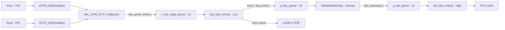
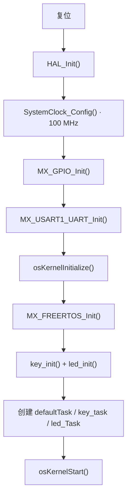

**简体中文** | [English](README.md)

[](LICENSE)

# STM32F411 FreeRTOS 中断按键控制 LED

一个面向 STM32F411CEU6 的完整嵌入式工程样例：使用 GPIO 外部中断采集两个按键的按下与释放边沿，在 FreeRTOS 任务中完成消抖、短按/长按识别，并通过消息队列将按键事件解耦为 LED 命令。

工程展示了从产品需求到可烧录固件的基本链路，重点包括中断与任务的职责分离、独立按键状态机、队列通信、边界值处理和硬件验收。

## 目录

- [功能概览](#功能概览)
- [设计亮点](#设计亮点)
- [按键时序定义](#按键时序定义)
- [硬件与软件环境](#硬件与软件环境)
- [快速开始](#快速开始)
- [系统架构](#系统架构)
- [详细设计](#详细设计)
- [工程结构](#工程结构)
- [配置参数](#配置参数)
- [测试与验收](#测试与验收)
- [运行约束](#运行约束)
- [故障排查](#故障排查)
- [许可说明](#许可说明)

## 功能概览

| 输入 | 识别结果 | 产品行为 |
|---|---|---|
| Key1 短按 | `KEY_EVENT_SHORT_PRESS` | PC13 LED 状态翻转一次 |
| Key1 长按 | `KEY_EVENT_LONG_PRESS` | PC13 LED 以 2 Hz 闪烁 3 次，结束后恢复原状态 |
| Key2 短按 | `KEY_EVENT_SHORT_PRESS` | USART1 输出 Key2 短按日志，LED 不变 |
| Key2 长按 | `KEY_EVENT_LONG_PRESS` | USART1 输出 Key2 长按日志，LED 不变 |
| 任一按键消抖区间或超时 | `KEY_EVENT_NONE` | 不产生产品响应 |

实现特性：

- Key1 与 Key2 分别使用 EXTI0、EXTI1，初始触发方式为下降沿。
- 中断回调只采集按键编号、边沿和时间戳，不在中断上下文执行产品逻辑。
- 每个按键维护独立状态机，可以分别记录按下和释放过程。
- 中断、按键识别、事件转换和 LED 执行通过三个 FreeRTOS 队列连接。
- 三个应用任务均以阻塞方式等待消息，空闲时不轮询按键。
- LED 为低电平点亮，上电初始化为点亮状态。

## 设计亮点

本工程最重要的价值不只是“按键控制 LED”，而是使用 C 语言实现了一套接近面向对象思维、职责清晰且便于扩展的嵌入式架构。这里的“面向对象”不是引入 C++ 类，而是通过结构体、枚举、模块私有数据和明确 API，把硬件、状态、事件与行为组织为相互解耦的对象与接口。

### 面向对象的 C 设计

按键被拆分为“硬件描述”和“运行实例”两个维度：

- `key_hardware_t` 描述 GPIO Port 和 Pin，只关心按键连接在哪里。
- `key_runtime_t` 保存状态机、按下 Tick、释放 Tick 和持续时间，只关心按键当前处于什么状态。
- `key_id_t` 提供稳定的逻辑身份，避免业务代码直接依赖物理引脚。
- `key_runtime[KEY_ID_COUNT]` 为每个按键创建独立运行实例，使 Key1、Key2 的状态互不污染。
- `key_hardware[KEY_ID_COUNT]` 使用表驱动方式完成逻辑按键到物理 GPIO 的映射。

这种拆分使同一套识别算法可以复用于多个物理按键，而不需要为 Key1、Key2 分别复制一套消抖和长按代码。

### 分层解耦

| 层次 | 代码实体 | 单一职责 | 不需要知道的内容 |
|---|---|---|---|
| 硬件采集层 | `HAL_GPIO_EXTI_Callback()` | 采集按键、边沿和时间戳 | 短按/长按规则、LED 行为 |
| 输入识别层 | `key_task_entry()` | 运行状态机并生成按键事件 | LED 引脚和闪烁实现 |
| 业务映射层 | `StartDefaultTask()` | 将 Key1 事件转换为 LED 命令 | EXTI、GPIO 有效电平 |
| 设备执行层 | `led_task_entry()` | 执行类型化 LED 命令 | 命令来自哪个按键 |

层与层之间只传递 `key_press_event_t`、`key_event_t` 和 `led_command_t`，不共享临时控制变量。这种事件驱动设计降低了模块耦合，也让输入设备、业务规则和输出设备能够分别替换或扩展。

### 类型化接口与明确错误语义

工程没有用零散整数表达状态和命令，而是为关键概念定义独立类型：

- `key_trigger_edge_t`：按下或释放边沿。
- `key_fsm_state_t`：按键状态机状态。
- `key_event_t`：无事件、短按或长按。
- `led_state_t`：LED 开、关或翻转。
- `led_command_t`：无命令、翻转或闪烁三次。
- `led_operate_result_t`、`led_process_result_t`：区分底层操作结果与命令处理结果。

初始化函数使用 `BaseType_t` 返回成功或失败；LED API 使用专用返回枚举；调用方检查队列创建、消息发送和命令执行结果，并在异常路径输出带模块标识的日志。`key_init()` 在部分资源创建失败时还会删除已创建队列并恢复句柄，避免半初始化状态继续运行。

### 封装与防御式设计

- 原始边沿队列 `s_key_edge_queue` 被声明为 `static`，限制在按键模块内部；外部只能消费已经分类的 `g_key_queue`。
- 按键 ID 在作为数组下标前会检查是否小于 `KEY_ID_COUNT`。
- 状态机包含 `default` 恢复路径，遇到非法状态时重置单个按键实例。
- 意外的重复下降沿不会污染其它按键，而是记录错误并重置当前实例。
- LED 的低电平有效细节被封装在 `led_operate()` 中，上层只使用 `LED_STATE_ON/OFF/TOGGLE`。
- 任务属性、硬件映射表以及只读配置使用 `const`，表达数据的所有权和可变性。

### 注释与 API 文档

核心 BSP 文件采用统一的文件头和 Doxygen 风格接口注释，明确记录：

- 模块职责、处理流程、依赖、版本和维护者。
- 函数的 `@brief`、输入参数、返回值、错误含义和调用上下文。
- ISR API 与任务 API 的使用边界。
- 队列初始化前置条件、队列容量以及任务长期运行语义。
- 枚举成员和结构体字段的业务含义。

因此，调用者可以先阅读头文件理解模块契约，再进入 `.c` 文件查看实现细节，符合可维护驱动模块的常见阅读顺序。

### 面向扩展的按键设计

`KEY_ID_COUNT` 同时承担按键数量和数组边界的角色。新增 Key3 时，可以沿用现有架构完成扩展：

1. 在 `key_id_t` 中添加 `KEY_ID_3`，并保持 `KEY_ID_COUNT` 位于末尾。
2. 增加 Key3 的 GPIO、EXTI 和 NVIC 配置。
3. 按枚举顺序向 `key_hardware[]` 增加一项物理映射。
4. `key_runtime[KEY_ID_COUNT]` 随数量自动扩展，为 Key3 提供独立状态实例。
5. 在结果路由处选择进入队列、输出日志或映射为新的业务事件。

识别算法、消抖边界和长按分类无需复制。类似地，新增 LED 动作时只需扩展 `led_command_t`、业务映射和 `led_process_command()`，按键采集层无需修改。

## 按键时序定义

按压持续时间使用无符号 Tick 差值计算：

```text
Δt = release_tick - press_tick
```

`press_tick` 和 `release_tick` 均由 `HAL_GetTick()` 在 GPIO EXTI 回调中采集。当前 HAL 时间基准为 1 ms。

| 持续时间 Δt | 分类 | 边界说明 |
|---:|---|---|
| `Δt < 10 ms` | 按键消抖 / 无效 | 10 ms 不属于此区间 |
| `10 ms ≤ Δt < 1000 ms` | 短按 | 包含 10 ms，不包含 1000 ms |
| `1000 ms ≤ Δt ≤ 5000 ms` | 长按 | 同时包含 1000 ms 和 5000 ms |
| `Δt > 5000 ms` | 超时 / 无效 | 5001 ms 起不产生有效事件 |

> [!NOTE]
> 短按和长按均在按键释放后判定。按住达到 1000 ms 时不会立即上报长按；释放后才会根据完整持续时间分类。

LED 长按动作每隔 250 ms 翻转一次，共翻转 6 次：

```text
半周期 = 250 ms
周期 T = 500 ms
频率 f = 2 Hz
总计   = 3 个完整周期
```

偶数次翻转保证闪烁完成后 LED 回到执行命令前的状态。

## 硬件与软件环境

### 硬件

- STM32F411CEU6 开发板（样例面向 WeAct STM32F411CEU6，等价引脚板卡也可适配）
- 两个低电平有效按键
- PC13 低电平有效 LED
- ST-Link 或兼容 SWD 调试器
- 3.3 V USB 转串口模块，用于查看 USART1 日志

### 引脚分配

| 功能 | MCU 引脚 | 配置 | 外部连接 |
|---|---|---|---|
| Key1 | PA0 / EXTI0 | 上拉输入、低电平按下 | 按键另一端接 GND |
| Key2 | PA1 / EXTI1 | 上拉输入、低电平按下 | 按键另一端接 GND |
| LED | PC13 | 推挽输出、低电平点亮 | 板载 LED 或等价外部电路 |
| USART1 TX | PA9 | 复用推挽输出 | 接 USB 转串口模块 RX |
| USART1 RX | PA10 | 异步串口输入 | 可选，接 USB 转串口模块 TX |
| SWDIO | PA13 | 调试接口 | 接调试器 SWDIO |
| SWCLK | PA14 | 调试接口 | 接调试器 SWCLK |

> [!IMPORTANT]
> MCU 与 USB 转串口模块必须共地，并使用 3.3 V 逻辑电平。两个按键在空闲时应保持高电平，按下后拉低。

### 工具链

仓库已经包含 STM32 HAL、CMSIS、FreeRTOS 内核和 Keil 工程文件，不需要另外下载这些源文件。

| 组件 | 工程配置或已验证版本 |
|---|---|
| MCU | STM32F411CEU6，Cortex-M4F，100 MHz |
| IDE / 工具链 | Keil MDK-ARM 5；工程日志使用 ARM Compiler 5.06 update 7 |
| Device Family Pack | Keil STM32F4xx DFP 2.17.1 |
| STM32Cube 固件包 | STM32Cube FW_F4 V1.28.3 |
| RTOS | FreeRTOS Kernel V10.3.1 + CMSIS-RTOS2 |
| 配置工具 | STM32CubeMX，可选，仅在修改 `.ioc` 时需要 |

## 快速开始

### 1. 连接硬件

按[引脚分配](#引脚分配)连接 Key1、Key2、串口和 SWD 调试器。若板上已有 PC13 LED，可直接使用；否则需要根据低电平点亮逻辑连接外部 LED 驱动电路。

### 2. 打开并编译工程

1. 使用 Keil µVision 打开 `MDK-ARM/STM32F411CEU6.uvprojx`。
2. 确认目标为 `STM32F411CEU6`，并已安装 STM32F4xx Device Family Pack。
3. 执行 **Rebuild all target files**。
4. 构建成功后，工程配置会在 `MDK-ARM/STM32F411CEU6/` 下生成 AXF 和 HEX 文件。

### 3. 烧录并运行

1. 通过 ST-Link 或兼容调试器连接目标板。
2. 在 Keil 中执行 **Download**。
3. 复位或重新上电，FreeRTOS 调度器启动后即可测试按键。

### 4. 打开串口日志

串口参数如下：

```text
USART1
115200 baud
8 data bits
1 stop bit
No parity
No flow control
```

Key2 的预期识别日志：

```text
[I][KEY] Key2 short press.
[I][KEY] Key2 long press.
```

Key1 控制 LED。当前调试输出还会在每次 LED 翻转成功后打印：

```text
TEST_LOG:LED toggle successfully.
```

## 系统架构

### 数据流



这条消息链把硬件采集、输入识别、业务映射和输出执行分为四层。按键模块不直接操作 LED，LED 模块也不依赖具体按键，因此两者可以独立演进。

### 启动流程



队列在任务创建前初始化；任一队列创建失败都会进入 `Error_Handler()`，防止任务在资源不完整时运行。

### 任务设计

| 任务 | 入口函数 | CMSIS 优先级 | 栈大小 | 职责 |
|---|---|---:|---:|---|
| `led_Task` | `led_task_entry` | High | 512 B | 接收并执行 LED 命令 |
| `defaultTask` | `StartDefaultTask` | Normal | 512 B | 将 Key1 事件映射为 LED 命令 |
| `key_task` | `key_task_entry` | Low | 512 B | 运行双按键状态机并分类按压时间 |

任务优先级关系为：

```text
led_Task > defaultTask > key_task
```

### 队列设计

| 队列 | 方向 | 元素类型 | 长度 | 用途 |
|---|---|---|---:|---|
| `s_key_edge_queue` | EXTI 回调 → `key_task` | `key_press_event_t` | 10 | 传递按键编号、边沿和 Tick；按键模块私有 |
| `g_key_queue` | `key_task` → `defaultTask` | `key_event_t` | 10 | 只传递 Key1 的短按或长按结果 |
| `g_led_queue` | `defaultTask` → `led_Task` | `led_command_t` | 10 | 传递 LED 翻转或闪烁命令 |

## 详细设计

### GPIO 外部中断

`MX_GPIO_Init()` 将 PA0 和 PA1 配置为上拉、下降沿触发，并将 EXTI0 和 EXTI1 的抢占优先级设为 5。

中断处理链如下：

1. `EXTI0_IRQHandler()` 或 `EXTI1_IRQHandler()` 调用 HAL EXTI 处理函数。
2. `HAL_GPIO_EXTI_Callback()` 根据 GPIO Pin 映射到 Key1 或 Key2。
3. 回调通过 `HAL_GetTick()` 记录当前边沿时间。
4. 读取 GPIO 实际电平：低电平视为按下，高电平视为释放。
5. 使用 `xQueueSendFromISR()` 将原始边沿事件发送到 `s_key_edge_queue`。
6. 当前按键被重新配置为相反边沿，等待完整的按下—释放过程。

```text
下降沿（按下） → 下一次等待上升沿
上升沿（释放） → 下一次等待下降沿
```

### 按键状态机

Key1 与 Key2 各有一个 `key_runtime_t` 实例，互不共享运行状态。

| 当前状态 | 收到边沿 | 处理 | 下一状态 |
|---|---|---|---|
| `KEY_FSM_WAIT_PRESS` | 下降沿 | 保存按下 Tick，清空旧计时 | `KEY_FSM_WAIT_RELEASE` |
| `KEY_FSM_WAIT_PRESS` | 上升沿 | 忽略无起点的释放 | `KEY_FSM_WAIT_PRESS` |
| `KEY_FSM_WAIT_RELEASE` | 上升沿 | 计算 Δt、分类事件、清理计时 | `KEY_FSM_WAIT_PRESS` |
| `KEY_FSM_WAIT_RELEASE` | 下降沿 | 记录异常日志并重置该按键状态机 | `KEY_FSM_WAIT_PRESS` |

完成分类后：

- Key1 的短按/长按结果以非阻塞方式写入 `g_key_queue`。
- Key2 的短按/长按结果直接在 `key_task` 任务上下文输出串口日志。
- `KEY_EVENT_NONE` 不向下游发送。

### 事件转换

`defaultTask` 只承担业务映射，不包含 GPIO 操作：

```text
KEY_EVENT_SHORT_PRESS → LED_CMD_TOGGLE
KEY_EVENT_LONG_PRESS  → LED_CMD_BLINK_3_TIMES
```

转换后的命令以非阻塞方式发送到 `g_led_queue`。

### LED 执行

`led_task_entry()` 阻塞等待 LED 命令，并调用 `led_process_command()`：

- `LED_CMD_NONE`：不操作。
- `LED_CMD_TOGGLE`：调用 HAL 翻转 PC13 一次。
- `LED_CMD_BLINK_3_TIMES`：每 250 ms 翻转一次，共翻转 6 次。
- 其它命令：返回 `LED_PROCESS_INVALID_COMMAND` 并输出错误日志。

`led_operate()` 统一封装低电平有效逻辑：`LED_STATE_ON` 输出低电平，`LED_STATE_OFF` 输出高电平。

## 工程结构

```text
.
├── BSP/
│   ├── key/
│   │   ├── inc/bsp_key.h       # 按键参数、事件类型、状态机和公共 API
│   │   └── src/bsp_key.c       # EXTI 回调、双按键识别任务和队列路由
│   └── led/
│       ├── inc/bsp_led.h       # LED 状态、命令、结果类型和公共 API
│       └── src/bsp_led.c       # LED 队列、底层操作与执行任务
├── Core/
│   ├── Inc/
│   │   ├── main.h              # Key1、Key2、LED 引脚定义
│   │   └── FreeRTOSConfig.h    # FreeRTOS Tick、堆和调度配置
│   └── Src/
│       ├── main.c              # HAL、外设、内核初始化和调度器启动
│       ├── freertos.c          # 队列/任务创建与 Key1 → LED 事件转换
│       ├── gpio.c              # GPIO、EXTI 和 NVIC 初始化
│       ├── stm32f4xx_it.c      # EXTI0、EXTI1 中断入口
│       └── usart.c             # USART1 初始化与 printf 重定向
├── Drivers/                    # CMSIS 与 STM32F4 HAL 驱动
├── Middlewares/                # FreeRTOS 内核与 CMSIS-RTOS2 适配层
├── MDK-ARM/                    # Keil 工程、启动文件和构建输出目录
├── STM32F411CEU6.ioc           # STM32CubeMX 工程配置
├── LICENSE                     # 本工程自定义代码的 MIT 许可证
├── README.md                   # GitHub 默认展示的英文文档
└── README_zh.md                # 简体中文文档
```

最核心的产品逻辑集中在：

- `BSP/key/inc/bsp_key.h` 与 `BSP/key/src/bsp_key.c`
- `BSP/led/inc/bsp_led.h` 与 `BSP/led/src/bsp_led.c`
- `Core/Src/freertos.c`
- `Core/Src/main.c`

## 配置参数

### 产品参数

| 宏或实现参数 | 当前值 | 位置 |
|---|---:|---|
| `KEY_DEBOUNCE_TIME_MS` | 10 ms | `BSP/key/inc/bsp_key.h` |
| `KEY_LONG_PRESS_TIME_MS` | 1000 ms | `BSP/key/inc/bsp_key.h` |
| `KEY_PRESS_TIMEOUT_MS` | 5000 ms | `BSP/key/inc/bsp_key.h` |
| LED 半周期 | 250 ms | `BSP/led/src/bsp_led.c` |
| LED 翻转次数 | 6 | `BSP/led/src/bsp_led.c` |
| 三个队列长度 | 各 10 个元素 | `bsp_key.c`、`bsp_led.c` |

修改按键边界时，应保持以下关系：

```text
0 < KEY_DEBOUNCE_TIME_MS < KEY_LONG_PRESS_TIME_MS <= KEY_PRESS_TIMEOUT_MS
```

### FreeRTOS 参数

| 参数 | 当前值 |
|---|---:|
| `configUSE_PREEMPTION` | 1 |
| `configTICK_RATE_HZ` | 1000 Hz |
| `configTOTAL_HEAP_SIZE` | 15360 B |
| `configMINIMAL_STACK_SIZE` | 128 words |
| `configMAX_PRIORITIES` | 56（CMSIS-RTOS2 适配要求） |

> [!CAUTION]
> 使用 STM32CubeMX 重新生成代码前，请提交或备份本地修改并检查生成差异。`Core/Src/freertos.c`、GPIO/中断配置和自定义 BSP 之间存在配套关系，不能只更新其中一处。

## 测试与验收

### 最小验收矩阵

建议使用逻辑分析仪、调试器或串口日志记录按下/释放时间，至少覆盖以下边界：

| 用例 | 输入 | 预期结果 |
|---|---:|---|
| 消抖区间 | 9 ms | Key1/Key2 均无有效响应 |
| 短按下边界 | 10 ms | 识别为短按 |
| 短按上边界 | 999 ms | 识别为短按 |
| 长按下边界 | 1000 ms | 识别为长按 |
| 长按上边界 | 5000 ms | 识别为长按 |
| 超时区间 | 5001 ms | Key1/Key2 均无有效响应 |
| Key1 短按 | 任一有效短按 | LED 只翻转一次 |
| Key1 长按 | 任一有效长按 | LED 2 Hz 闪烁 3 次并恢复原状态 |
| Key2 短按/长按 | 任一有效按压 | USART1 日志正确，LED 不变 |
| 双按键交错 | Key1、Key2 交错操作 | 两个状态机互不污染，事件来源正确 |

### 分层验证建议

1. **静态检查**：检查编译告警，并按项目规范执行 MISRA C、Polyspace、Understand 或同类分析。
2. **单元验证**：分别验证 EXTI 采集、按键状态机、事件映射和 LED 命令处理。
3. **冒烟测试**：完成烧录后先确认 Key1、Key2、LED 和 USART1 的基本通路。
4. **集成测试**：验证三条队列上的类型、顺序和满载行为。
5. **性能测试**：使用额外 GPIO 或 RTOS 统计功能测量中断延迟、任务响应和 CPU 占用。
6. **系统测试**：按上表执行产品功能与全部边界值验收。

仓库目前没有主机端自动化单元测试或 CI 配置，最终验收需要在目标板上完成。

## 运行约束

- 按键结果只在释放边沿到达后产生，长按期间不会周期上报。
- `g_key_queue` 和 `g_led_queue` 使用零等待发送；队列已满时当前事件会被丢弃并输出错误日志。
- 原始边沿队列同样从 ISR 非阻塞发送。高频抖动或异常输入可能占满 10 个元素的队列。
- LED 三次闪烁命令在 `led_Task` 中使用六次 `vTaskDelay(250 ms)`，单条命令约占用该任务 1.5 s；期间新命令保存在 LED 队列中。
- `printf` 通过 USART1 逐字符阻塞发送，仅适合调试日志；高日志量会影响实时性。
- 当前设计动态切换 GPIO 的下一触发边沿。若修改 EXTI 处理方式，需要同时复核按键状态机的异常边沿策略。

## 故障排查

### 按键没有响应

- 确认按键空闲为高电平、按下接地，而不是高电平有效接法。
- 确认 Key1 使用 PA0/EXTI0，Key2 使用 PA1/EXTI1。
- 检查 EXTI0、EXTI1 已使能，且 NVIC 优先级保持为允许调用 FreeRTOS FromISR API 的配置。
- 检查 `key_init()` 成功创建 `s_key_edge_queue` 和 `g_key_queue`。

### Key2 没有串口日志

- 确认 USB 转串口模块 RX 接 PA9，双方共地。
- 确认终端为 115200、8N1、无流控。
- 确认使用 3.3 V TTL 串口，而不是 RS-232 电平。

### Key1 长按后 LED 状态异常

- 确认 LED 是 PC13 低电平有效。
- 检查是否在 1.5 s 闪烁执行期间连续加入了其它 Key1 命令。
- 使用串口中的 LED 翻转日志或逻辑分析仪确认是否完整执行 6 次翻转。

### CubeMX 重新生成后行为变化

- 对照 `STM32F411CEU6.ioc` 检查 PA0、PA1 的上拉和初始下降沿配置。
- 检查 EXTI0/EXTI1 中断入口和优先级是否保留。
- 检查 `MX_FREERTOS_Init()` 是否仍在创建 BSP 队列和三个应用任务。

## 许可说明

本工程的自定义代码采用 [MIT License](LICENSE)，版权所有：

```text
Copyright (c) 2026 JesMicro
```

MIT License 允许使用、复制、修改、合并、发布、分发、再许可及销售本工程代码，但必须保留版权与许可声明；软件按“原样”提供，不附带任何明示或默示担保。

`Drivers/`、`Middlewares/`、STM32 HAL、CMSIS 和 FreeRTOS 等第三方组件继续适用其各自的版权与许可条款，根目录 MIT License 不会替代这些第三方声明。复制、修改、再分发或用于商业产品前，请同时核对对应源文件和第三方目录中的许可文本。

## 参考资料

- [FreeRTOS 官方文档](https://docs.freertos.org/)
- [CMSIS-RTOS2 API](https://arm-software.github.io/CMSIS_6/latest/RTOS2/index.html)
- [STM32CubeF4 官方仓库](https://github.com/STMicroelectronics/STM32CubeF4)

## 许可证

本项目采用 **MIT License** 开源许可证。Copyright (c) 2026 JesMicro。完整条款请参阅根目录的 [LICENSE](LICENSE) 文件。第三方组件遵循各自的许可证。
