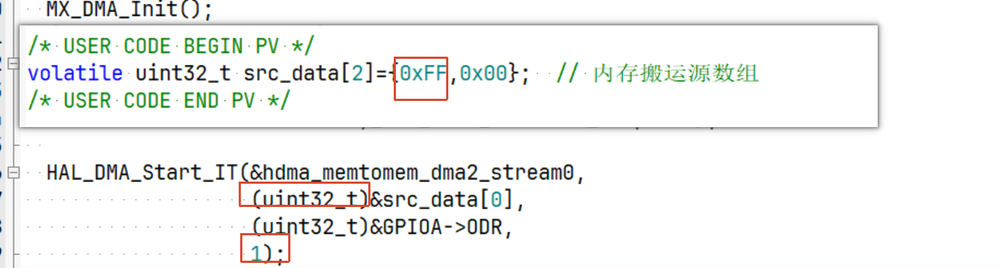

**English** | [简体中文](README_zh.md)

[](LICENSE)

# STM32F411 DMA Memory-to-GPIO Experiment

## Project Description

##### Introduction

This project uses the STM32F411 DMA controller to transfer data from memory to the GPIOA output data register (ODR). The PA6 waveform demonstrates DMA polling, interrupts, and callbacks.

##### Main Features

- Repeatedly transfer `0xFF` and `0x00`;
- Provide polling and interrupt-driven implementations;
- Verify the PA6 output with a logic analyzer.

##### Repository Structure

```text
Core/       Application code and interrupt handlers
Drivers/    HAL and CMSIS drivers
MDK-ARM/    Keil project
*.ioc       CubeMX configuration
```

## Usage Guide

##### Environment and Dependencies

STM32F411CEU6, STM32CubeMX 6.16.1, STM32Cube FW_F4 V1.28.3, Keil MDK, and a logic analyzer.

##### Hardware Connection and Configuration

Connect the logic analyzer to PA6 and share ground with the development board. DMA2 Stream0 transfers one byte-aligned data unit at a time to the ODR.

##### Build, Run, and Observe

Open `MDK-ARM/STM32F411CEU6.uvprojx` in Keil, build and flash the project, and then reset the board. PA6 should continuously alternate between high and low levels.

##### Porting Notes

When changing the MCU, reconfigure the GPIO, DMA stream/channel, and interrupt in CubeMX.

## Author's Notes

1. In interrupt-driven mode, `HAL_DMA_RegisterCallback()` must be called after `HAL_DMA_Init()` and before `HAL_DMA_Start_IT()`.

2. In the commented-out polling implementation, if `HAL_DMA_PollForTransfer()` is not called, the hardware may finish the transfer while the HAL DMA state remains busy. The next `HAL_DMA_Start()` then returns `HAL_BUSY`, and delaying does not update the HAL state. **As a result, a continuous waveform may not be produced.**

3. 

   1. Why can `0xFF` be assigned to a `uint32_t` element?

      > `0xFF` represents the value 255; it does not mean that the value can only occupy one byte. The number of hexadecimal digits describes the value, not the storage size.
      >
      > When assigned to a `uint32_t`, `0xFF` is stored as `0x000000FF`, while `0x00` is stored as `0x00000000`. Each element still occupies four bytes, with its upper 24 bits set to zero.

   2. What type of pointer is produced by taking the address, and why is a cast required?

      > The resulting type is `volatile uint32_t *`, which points to a 32-bit `uint32_t` element.
      >
      > On the STM32F411, the address stored by the pointer is also 32 bits. Even a `uint8_t *` pointer stores a 32-bit address; it simply points to 8-bit data. In this case, the pointer stores a 32-bit address and points to 32-bit data.
      >
      > However, the address parameters of `HAL_DMA_Start_IT()` are 32-bit `uint32_t` integer addresses rather than pointer types, so explicit casts are required.

   3. What does a transfer length of `1` mean? Does it mean one byte?

      > The length specifies one DMA transfer unit, whose size is determined by the DMA alignment setting:
      >
      > - Byte: one byte per unit;
      > - Half-word: two bytes per unit;
      > - Word: four bytes per unit.
      >
      > This alignment is selected when configuring DMA in CubeMX.

## License

This project is licensed under the **MIT License**. Copyright (c) 2026 JesMicro. See the [LICENSE](LICENSE) file in this project's root for the full terms. Third-party components are subject to their respective licenses.
