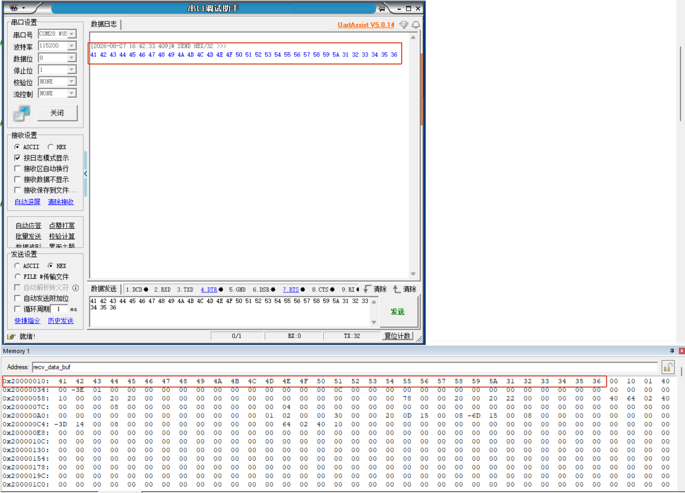
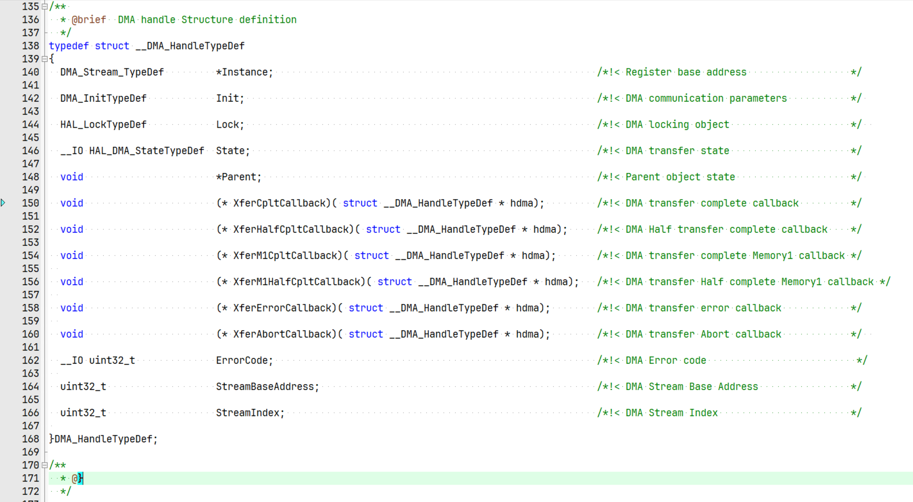

**English** | [简体中文](README_zh.md)

[](LICENSE)

# STM32F411CEU6 USART1 DMA Reception to SRAM

## Project Description

This project demonstrates how USART1 uses DMA to receive serial data into an SRAM buffer and restarts reception through a completion callback in normal mode.

##### Introduction

The project is based on the STM32F411CEU6 and focuses on the interaction between UART, DMA, and receive-complete callbacks.

##### Main Features

- USART1 reception at 115200 baud with an 8N1 frame format.
- DMA2 Stream2 transfers 32 bytes into SRAM.
- The completion callback restarts reception in DMA normal mode.

##### Repository Structure

```text
Core/          Application code and peripheral initialization
Drivers/       CMSIS and STM32F4 HAL drivers
MDK-ARM/       Keil MDK project
Docs/Images/   README images
*.ioc          STM32CubeMX configuration file
```

## Usage Guide

Connect the serial interface, flash the program, send fixed-length data, and inspect the receive buffer with a debugger.

##### Environment and Dependencies

- STM32F411CEU6 development board, USB-to-UART adapter, and programmer/debugger.
- STM32CubeMX 6.16.1, STM32CubeF4 1.28.3, and Keil MDK-ARM 5.32.
- Any serial terminal that supports 115200 baud and 8N1.

##### Hardware Connection and Configuration

| STM32F411CEU6 | USB-to-UART |
| --- | --- |
| PA10 / USART1_RX | TX |
| PA9 / USART1_TX | RX (optional) |
| GND | GND |

Use 115200 baud, 8 data bits, 1 stop bit, no parity, and no flow control. Ensure compatible logic levels.

##### Build, Run, and Observe

1. Open `MDK-ARM/STM32F411CEU6.uvprojx` in Keil, then build and flash it.
2. Send 32 bytes over the serial port, for example `ABCDEFGHIJKLMNOPQRSTUVWXYZ123456`.
3. Inspect `recv_data_buf` in the debugger and confirm that the data is stored in SRAM.

   

##### Porting Notes

When changing the MCU or UART instance, reconfigure the UART pins, DMA Stream/Channel, interrupt handler, and receive-buffer length according to the target datasheet.

## Author's Notes

##### Project-Related Reflections

1. What are `XferCpltCallback` and the related members shown below?

   

   >They are function pointers in the DMA handle that specify which function is called for each DMA event.
   >
   >For example:
   >• `XferCpltCallback`: called when the entire transfer is complete.
   >• `XferHalfCpltCallback`: called when half of the transfer is complete.
   >• `XferErrorCallback`: called when a transfer error occurs.
   >• `XferAbortCallback`: called when a transfer is aborted. It is currently a null pointer, so no function is registered.

2. Why does the DMA callback call a UART function?

   >DMA is transferring data received by UART. After the DMA reception is complete, a UART internal function updates the UART state and then notifies the user layer that reception has finished.

3. Why does DMA not rely on the user callback to transfer data?

   >DMA hardware automatically moves data from the UART data register to the target address in SRAM; the user callback does not participate in the transfer. `HAL_UART_RxCpltCallback` only notifies the user that reception is complete.
   >
   >- Normal mode: DMA is usually restarted in the callback.
   >- Circular mode: DMA cycles automatically and does not need to be restarted.

4. Complete callback chain

   ```c
   Initialize DMA and UART
       ↓
   HAL_UART_Receive_DMA()
       ↓
   UART_Start_Receive_DMA()
   Register DMA callbacks and start DMA
       ↓
   DMA automatically transfers 32 bytes
       ↓
   DMA2_Stream2_IRQHandler()
       ↓
   HAL_DMA_IRQHandler()
       ↓
   XferCpltCallback()
       ↓
   UART_DMAReceiveCplt()
       ↓
   HAL_UART_RxCpltCallback()
       ↓
   Restart DMA in normal mode
   ```

##### Other Reflections

None at present.

## License

This project is licensed under the **MIT License**. Copyright (c) 2026 JesMicro. See the [LICENSE](LICENSE) file in this project's root for the full terms. Third-party components are subject to their respective licenses.
