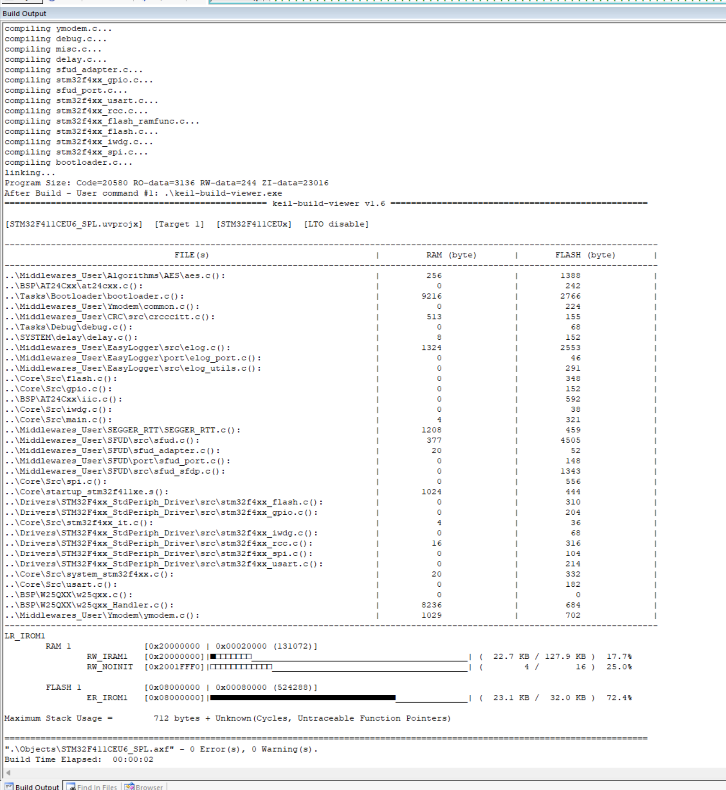
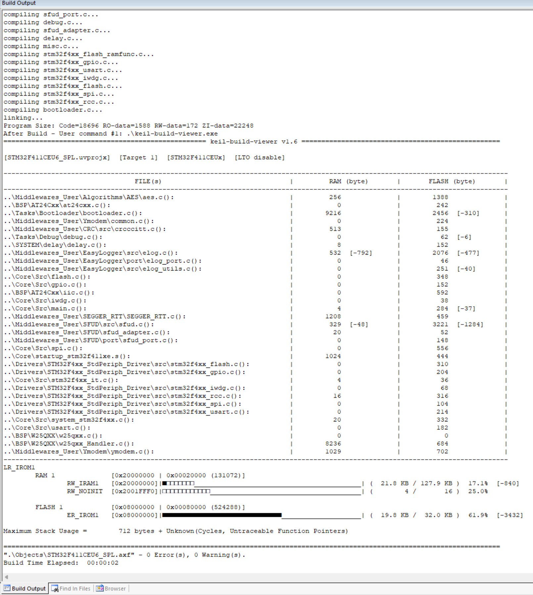

**简体中文** | [English](README.md)

[](LICENSE)

# STM32F411 OTA：Bootloader 资源占用优化

本阶段针对 Bootloader 的 EasyLogger 和 SFUD 进行功能裁剪，为后续功能预留空间。根据全量编译结果，Bootloader 的 Flash 占用由 **23.40 KB 降至 19.98 KB**，静态 RAM 占用由 **22.71 KB 降至 21.89 KB**，分别减少 **3.42 KB** 和 **0.82 KB**。优化后已上板验证，功能正常。

## 工程组成

| 工程 | 实现与用途 | 使用说明 |
| --- | --- | --- |
| 01_Bootloader | SPL 裸机工程，接收、解密、安装固件并管理启动状态；本次资源优化的对象 | [Bootloader README](03_Firmware/01_Bootloader/README_zh.md) |
| 02_APP1 | HAL / FreeRTOS 应用，接收升级包；输出 APP1 日志，应用线程延时 500 ms | [APP1 README](03_Firmware/02_APP1/README_zh.md) |
| 03_APP2 | 由 APP1 复制的升级验证应用；输出 APP2 日志，应用线程延时 200 ms | [APP2 README](03_Firmware/03_APP2/README_zh.md) |

```text
03_Firmware/
├── 01_Bootloader/          资源优化后的 Bootloader
├── 02_APP1/                初始应用与升级包接收
├── 03_APP2/                升级目标验证应用
└── 04_BIN_EncryptionBIN/   APP1 / APP2 加密包
08_docs/
└── image/                 优化前后的资源统计截图
```

## 优化内容

先通过编译生成的 `.map` 文件和 keil-build-viewer 统计各模块占用，再裁剪固定硬件和基础日志不需要的功能。本轮修改集中在 `03_Firmware/01_Bootloader/`；APP1、APP2 保留各自现有的中间件配置。

### EasyLogger

| 调整项 | 优化前 | 优化后 |
| --- | --- | --- |
| 单行日志缓冲区 `ELOG_LINE_BUF_SIZE` | 1024 B | 256 B |
| 颜色输出 `ELOG_COLOR_ENABLE` | 开启 | 关闭 |
| 函数名、文件路径、行号 | 开启 `ELOG_FMT_USING_FUNC`、`ELOG_FMT_USING_DIR`、`ELOG_FMT_USING_LINE` | 关闭三个宏 |
| 各等级输出格式 | 时间、等级、标签、文件路径、行号、函数名 | 仅 `ELOG_FMT_LVL \| ELOG_FMT_TAG`，加日志正文 |

配置在 [elog_cfg.h](03_Firmware/01_Bootloader/Middlewares_User/EasyLogger/inc/elog_cfg.h)，初始化在 [debug.c](03_Firmware/01_Bootloader/Tasks/Debug/debug.c)。颜色函数调用使用 `#ifdef ELOG_COLOR_ENABLE` 保护，保证关闭颜色功能后不引用被裁剪的函数。

单行缓冲区缩小直接节省 768 B 静态 RAM，颜色和格式配置进一步减少相关数据与日志字符串。异步输出和缓冲输出在优化前就已关闭，本轮继续使用同步输出。保留必要日志和断言，日志等级仍为 `ELOG_LVL_VERBOSE`；256 B 是整行缓冲区大小，过长日志会截断。

### SFUD

硬件固定使用 W25Q64，因此关闭自动参数发现和通用芯片参数表，保留基本读写、擦除及单线快速读。

| 配置项 | 优化后配置 |
| --- | --- |
| `SFUD_USING_SFDP` | 关闭 |
| `SFUD_USING_FLASH_INFO_TABLE` | 关闭 |
| `SFUD_USING_FAST_READ` | 保留开启 |
| `SFUD_FLASH_DEVICE_TABLE` | 保留设备索引、名称、SPI1 和固定芯片参数 |
| 芯片容量 | 8 MiB（`8UL * 1024UL * 1024UL`） |
| 写入模式 | `SFUD_WM_PAGE_256B`，256 字节页编程 |
| 擦除粒度 / 命令 | 4096 B / `0x20` |

上述配置位于 [sfud_cfg.h](03_Firmware/01_Bootloader/Middlewares_User/SFUD/inc/sfud_cfg.h)。设备名称 `W25Q64` 只是标签；关闭两个参数来源后，必须在设备表的 `.chip` 中明确填写容量、写入模式和擦除参数。初始化使用固定参数，后续更换芯片时需同步核对配置。4 KiB 擦除粒度与现有 W25Q 管理层一致。

## 优化前后资源对比

以下为 **Bootloader 整个工程**的占用，包含中间件、业务代码及链接库，不是三个固件的合计。原始字节数来自优化前后全量编译的 `Program Size`；优化后的合计也与 `.map` 文件一致。两次统计均显示 LTO 未开启。

| 指标 | 优化前（B） | 优化后（B） | 减少（B） |
| --- | ---: | ---: | ---: |
| Code | 20,580 | 18,696 | 1,884 |
| RO-data | 3,136 | 1,588 | 1,548 |
| RW-data | 244 | 172 | 72 |
| ZI-data | 23,016 | 22,248 | 768 |

| 资源 | 优化前 | 优化后 | 减少 | 降幅 |
| --- | ---: | ---: | ---: | ---: |
| Flash | 23,960 B / 23.40 KB | 20,456 B / 19.98 KB | **3,504 B / 3.42 KB** | **14.62%** |
| 静态 RAM | 23,260 B / 22.71 KB | 22,420 B / 21.89 KB | **840 B / 0.82 KB** | **3.61%** |

本页 KB 按 1024 B 换算（即 KiB）。计算口径为：

- **Flash = Code + RO-data + RW-data**，包含已初始化数据在 Flash 中的初始值。
- **静态 RAM = RW-data + ZI-data**，不代表运行时栈峰值。

截图下方 keil-build-viewer 的 Flash 差值为 3,432 B，对应 `Code + RO-data` 的变化。加上 RW-data 初始值减少的 72 B，完整 Flash 占用减少 3,504 B，即 3.42 KB。

### 优化前



### 优化后



## 编译与验证

环境为 STM32F411CEU6、W25Q64、AT24C02，Keil MDK 5 / ARMCC 5.06 update 7；调试使用 J-Link / RTT Viewer，固件传输使用支持 YMODEM 的串口工具及配套加密工具。

1. 打开 `03_Firmware/01_Bootloader/MDK-ARM/STM32F411CEU6_SPL.uvprojx`，执行全量编译，并保存 `.map` 和资源统计。
2. APP1、APP2 链接地址为 `0x08008000`；生成 BIN 后加密为 `.mxxx`，用于首次安装及 APP1 → APP2 升级验证。
3. 烧录 Bootloader，按各工程 README 的流程完成下载、安装和启动，通过 RTT 日志区分运行的 APP。

优化后全量编译结果为 **0 Errors、0 Warnings**，已完成上板功能验证，未发现问题。

文中涉及的固件样本和编译产物需按对应工程说明在本地重新生成。

## 许可证

本项目采用 **MIT License** 开源许可证。Copyright (c) 2026 JesMicro。完整条款请参阅根目录的 [LICENSE](LICENSE) 文件。第三方组件遵循各自的许可证。
