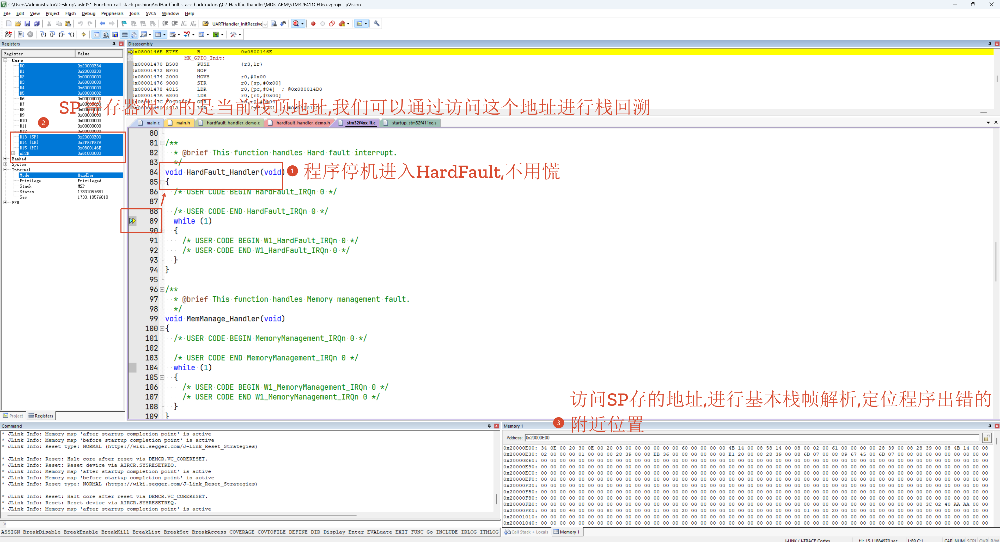
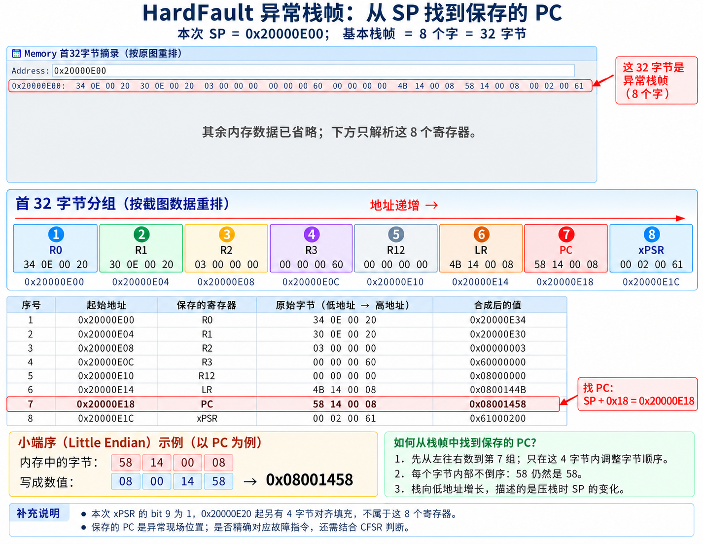
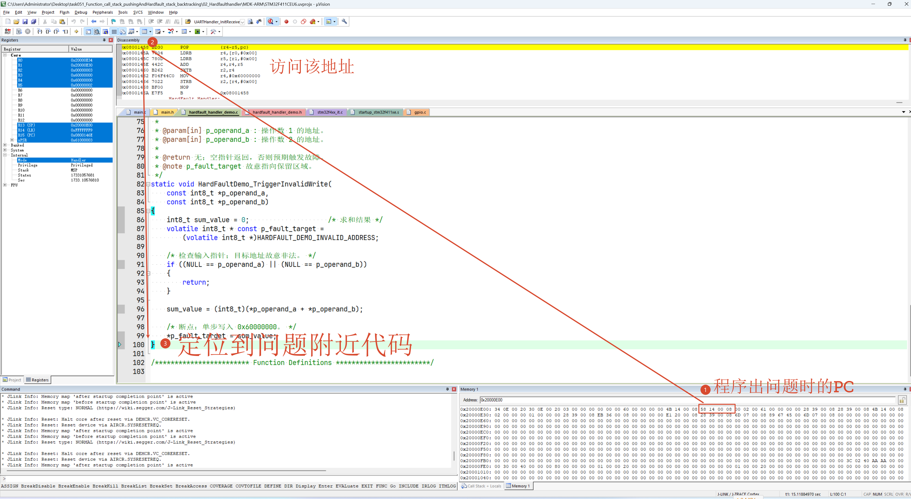

**简体中文** | [English](README.md)

[](LICENSE)

# STM32F411 HardFault 非法写入实验

## 项目说明

基于 STM32F411CEU6，将操作数 `1`、`2` 的求和结果写入保留地址
`0x60000000`，用于观察非法访问触发的 HardFault。

调用路径为 `main → HardFaultDemo_Run → HardFaultDemo_TriggerInvalidWrite`。
输入指针指向有效变量，故障由目标地址的故意非法写入产生。

##### 工程结构

```text
Business/          HardFault 测试模块
Core/              main 入口、外设配置与异常处理入口
Drivers/           HAL 与 CMSIS
MDK-ARM/           Keil 工程与启动文件
Middlewares_User/  SEGGER RTT 与 EasyLogger
```

## 工程使用指南

##### 环境与连接

- STM32F411CEU6 开发板，系统时钟 100 MHz。
- Keil MDK 5，ARMCC 5.06 update 7；HAL 与 CMSIS 源码随工程提供。
- 通过 SWD 连接调试器，并连接参考电压与公共地。
- 可选串口：PA9 → 转串口模块 RX、PA10 → TX、GND → GND；
  使用 3.3 V TTL 电平，参数为 115200、8N1。

##### 编译、运行与观测

1. 打开 [Keil 工程](MDK-ARM/STM32F411CEU6.uvprojx)，使用 `-O0` 并启用调试信息，编译、下载后进入调试。
2. 在 `*p_fault_target = sum_value;` 和 `HardFault_Handler()` 内设置断点，复位后运行。
3. 在写入前确认 `sum_value` 为 `3`，目标地址为 `0x60000000`，再继续执行。
4. 进入异常处理后，查看 `SCB->HFSR`、`SCB->CFSR`、SP 和 LR；仅在 `BFARVALID` 为 1 时读取 `SCB->BFAR` 作为有效故障地址。

默认未使能 BusFault，访问错误升级为 HardFault，程序停在现有异常处理循环中。
写缓冲保持默认配置，故障可能延后上报，异常现场的 PC 不一定对应写入指令。
重新测试需复位。

##### 移植说明

将 `Business/hardfault_handler_demo.c` 加入目标工程并配置头文件路径，
在初始化后调用 `HardFaultDemo_Run()`。更换芯片时重新核对保留地址与故障配置；
CubeMX 生成文件中的用户逻辑放在 `USER CODE` 区域。

## 作者思考

##### 1. 停机确认现场

不预设断点全速运行，停机后发现程序已进入 `HardFault_Handler()`，先记录三个关键寄存器：

| 寄存器 | 本次值 | 含义 |
|---|---|---|
| SP | `0x20000E00` | 当前栈顶，本次从这里读取异常栈帧 |
| LR | `0xFFFFFFF9` | 异常返回标记：现场保存在 MSP，使用无浮点扩展的基本栈帧 |
| PC | `0x0800146E` | 当前停在 HardFault 的死循环中 |



##### 2. 解析异常栈帧

在 Memory 输入 `0x20000E00`。本次异常处理函数没有额外压栈，
从这里按每 4 字节一组，依次读取 `R0、R1、R2、R3、R12、LR、PC、xPSR`。

保存的 PC 位于 `SP + 0x18 = 0x20000E18`。
按小端序将字节 `58 14 00 08` 合成为 `0x08001458`；每个字节内部不倒序。



图中 R12 的合成值应为 `0x00000000`。

##### 3. 回到源码排查

在 Disassembly 查看 `0x08001458`，结合反汇编检查附近源码。
保存的 PC 是否精确对应故障指令，需结合 CFSR 判断。
本例重点检查 `0x08001466` 的 `STRB`，对应 `*p_fault_target = sum_value;`。



##### 4. 修复后复测

修正可疑代码后重新编译、下载，在相同条件下反复测试；
结合故障原因与复测结果，确认问题是否解决。

## 许可证

本项目采用 **MIT License** 开源许可证。Copyright (c) 2026 JesMicro。完整条款请参阅根目录的 [LICENSE](LICENSE) 文件。第三方组件遵循各自的许可证。
