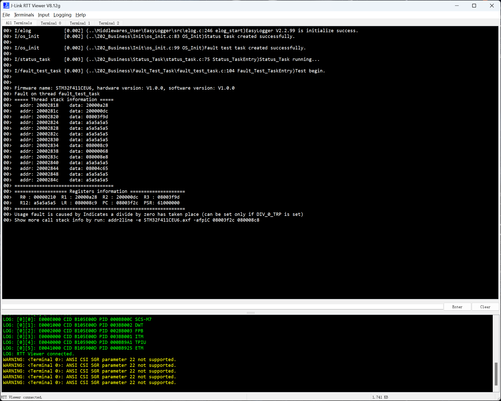
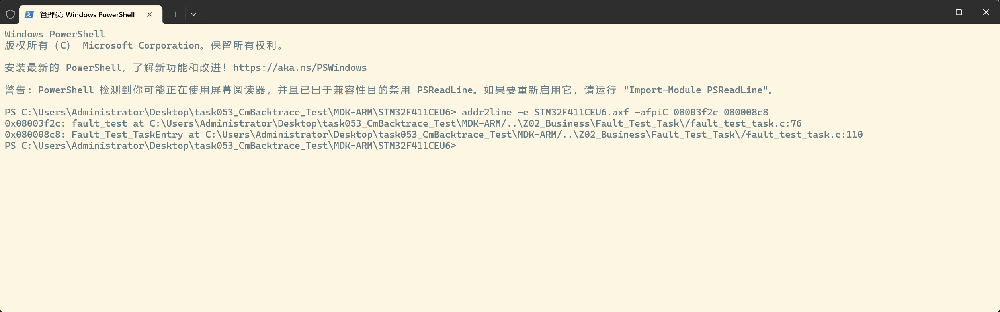

**简体中文** | [English](README.md)

[](LICENSE)

# STM32F411CEU6 CmBacktrace 除零异常测试

基于 FreeRTOS、CmBacktrace、SEGGER RTT 和 EasyLogger，验证“触发异常 → 输出现场 → 定位源码”的流程。HAL 使用 TIM1 时基，输出走 RTT 通道 0，上行缓冲区为 2 KB。

## 测试内容

- `OS_Init()` 使用 FreeRTOS 原生 API 创建任务。状态任务测试 LED 和日志。
- `fault_test_task` 优先级为 1，栈深度为 128 个元素（512 字节）。任务使能 `DIV_0_TRP`，执行 `10 / 0`。
- CmBacktrace 输出线程名、栈、寄存器和除零原因。异常未恢复时不会打印 `Test over.`。

## 运行与定位

1. 使用 Keil MDK-ARM / ARMCC 5 打开 `MDK-ARM/STM32F411CEU6.uvprojx`，编译并下载。
2. 通过 J-Link RTT Viewer 查看通道 0，获取故障日志。



从工程根目录打开 PowerShell，运行截图对应的示例命令。需先将 `addr2line` 加入 PATH：

```powershell
Set-Location .\MDK-ARM\STM32F411CEU6
addr2line -e .\STM32F411CEU6.axf -afpiC 08003f2c 080008c8
```

结果定位到 `fault_test:76` 和调用者 `Fault_Test_TaskEntry:110`；后者对应返回地址。



地址与行号随编译变化。使用当前日志中的地址，以及与板上固件对应的 `.axf`。

## CubeMX 维护

重新生成后，保留 `OS_Init()` 调用、`cmb_fault.S` 异常入口和 FreeRTOS 栈深度适配。

文中涉及的固件样本和编译产物需按对应工程说明在本地重新生成。

## 许可证

本项目采用 **MIT License** 开源许可证。Copyright (c) 2026 JesMicro。完整条款请参阅根目录的 [LICENSE](LICENSE) 文件。第三方组件遵循各自的许可证。
