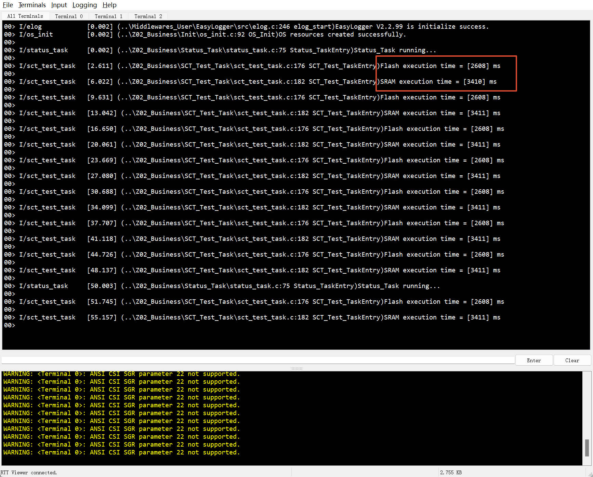

**简体中文** | [English](README.md)

# STM32F411CEU6 SCT 分散加载实验

本实验在 STM32F411CEU6 上验证 SCT 分散加载，将指定函数放入不同 Flash 区域和 SRAM，以相同逻辑比较调用耗时，并通过 MAP 文件和板上日志确认结果。芯片具有 512 KB Flash 和 128 KB SRAM。

## 实验实现

业务代码位于 `Z02_Business/SCT_Test_Task`，由 `Z02_Business/Init/os_init.c` 中的 `OS_Init()` 使用原生 `xTaskCreate()` 创建。每组通过两个 `volatile` 函数指针依次调用测试函数，循环一千万次，使用 `HAL_GetTick()` 记录毫秒耗时，经 `elog_i` 输出，每轮结束延时一秒。状态任务保留 LED 翻转和日志，间隔约五十秒。

FreeRTOS 内核通过 CMSIS V2 初始化与启动，业务任务使用原生接口；HAL 使用 TIM1 时基，日志经 EasyLogger 和 RTT 输出。

## 编译运行

1. 使用 Keil MDK、ARMCC 5.06 update 7（build 960），打开 `MDK-ARM/STM32F411CEU6.uvprojx`。
2. 在 Linker 中取消 `Use Memory Layout from Target Dialog`，将 Scatter File 设为 `.\STM32F411CEU6\User_sct\user_sct.sct`（相对 MDK 工程目录）。
3. 执行 Rebuild，下载固件，通过 J-Link RTT Viewer 的通道 0 观察日志。

自定义 SCT 将普通代码放在起始地址为 `0x08000000` 的区域，将 `myflash` 放入 `0x08070000` 起始的最后 64 KB Flash，并将 `myram` 的执行位置安排在 `0x20000000` 起始的 SRAM。SRAM 代码的加载地址仍在 Flash，启动时由运行库复制到 SRAM。

重新生成 CubeMX 代码后，应保留自定义 SCT 路径、任务创建入口和段属性，并重新检查 MAP 布局。

## 验证结果

完整编译为 **0 错误、0 警告**。检查新生成的 `MDK-ARM/STM32F411CEU6/STM32F411CEU6.map` 中函数的执行地址，确认 Flash 函数以 `0x080` 开头、SRAM 函数以 `0x200` 开头，不能仅凭编译成功判断分散加载生效。注意区分加载地址和执行地址，加载地址在 Flash 并不代表代码仍在 Flash 执行。

板上实测 Flash 约 **2.61 秒**，SRAM 约 **3.41 秒**；这些耗时包含循环、调用及中断和调度开销，仅代表当前测试配置。

文中涉及的固件样本和编译产物需按对应工程说明在本地重新生成。

## 许可证

本项目采用 **MIT License** 开源许可证。Copyright (c) 2026 JesMicro。完整条款请参阅根目录的 [LICENSE](LICENSE) 文件。第三方组件遵循各自的许可证。
