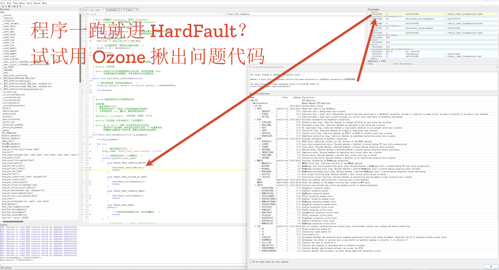

**简体中文** | [English](README.md)

# STM32F411CEU6 故障测试

本工程基于 FreeRTOS、SEGGER RTT 和 EasyLogger，复现三个故障场景，供 Keil/Ozone 调试练习。CMSIS V2 启动内核，HAL 使用 TIM1 时基。

## 任务与用例

`OS_Init()` 统一创建业务任务：`Status_Task` 每隔 10 秒翻转 LED 并输出日志；`Fault_Test_Task` 每轮先输出运行日志，再选择测试，正常流程延时 1 秒后重复。

| 选择值 | 枚举 | 操作 |
| --- | --- | --- |
| 0 | `FAULT_TEST_NONE` | 不触发故障 |
| 1 | `FAULT_TEST_INVALID_WRITE` | 向 `0x60000000` 写入 8 位数据 |
| 2 | `FAULT_TEST_DIVIDE_BY_ZERO` | 开启除零陷阱，执行 `10 / 0` |
| 3 | `FAULT_TEST_INVALID_READ` | 从 `0xFFFFFFFF` 读取 32 位数据 |

选择变量 `g_fault_test_case` 位于 `Z02_Business/Fault_Test_Task/fault_test_task.c`，使用 `static volatile`，仅供模块内部使用。当前初值为非法写入；查看周期日志时先设为 `FAULT_TEST_NONE`。可修改初值后重新编译，或在调试器中修改变量。

## 使用与验证

使用 Keil MDK-ARM / ARMCC 5 打开 `MDK-ARM/STM32F411CEU6.uvprojx`，编译并下载，通过 J-Link RTT Viewer 通道 0 查看日志。在 `HardFault_Handler()` 设置断点，每次选择一个用例，故障后复位再测试下一个。

三个用例均已实机验证可进入 HardFault。非法写入原因为 BusFault，除零原因为 UsageFault；具体原因结合 `HFSR`、`CFSR` 判断。非法读取还涉及未对齐和跨地址空间边界，应以故障寄存器为准。

ARMCC V5.06 update 7（build 960）编译结果：**0 错误、0 警告**。CubeMX 重新生成代码后，检查 `OS_Init()` 调用、默认线程禁用、TIM1 时基、日志初始化、RTT 重定向及 Keil 业务文件引用。

文中涉及的固件样本和编译产物需按对应工程说明在本地重新生成。

## 许可证

本项目采用 **MIT License** 开源许可证。Copyright (c) 2026 JesMicro。完整条款请参阅根目录的 [LICENSE](LICENSE) 文件。第三方组件遵循各自的许可证。
