**English** | [简体中文](README_zh.md)

[](LICENSE)

# AHT21 Layered Driver

An embedded C driver and application integration example for the AHT21 temperature and humidity sensor. Structures, function pointers, and dependency injection separate the sensor protocol, measurement request handling, platform resource adaptation, and application tasks into distinct layers. This organization helps explain driver design, replace platform interfaces, and reuse the measurement flow.

The repository includes a complete **STM32F411CEU6 + GPIO software I²C + FreeRTOS** integration project. Initialization, queued requests, temperature and humidity acquisition, callback delivery, and cache reuse have been exercised on hardware. The Driver handles measurement commands, status checks, CRC-8 verification, and conversion to physical units. The Handler receives requests, manages cached readings, and delivers results from its worker thread.

## Layered architecture

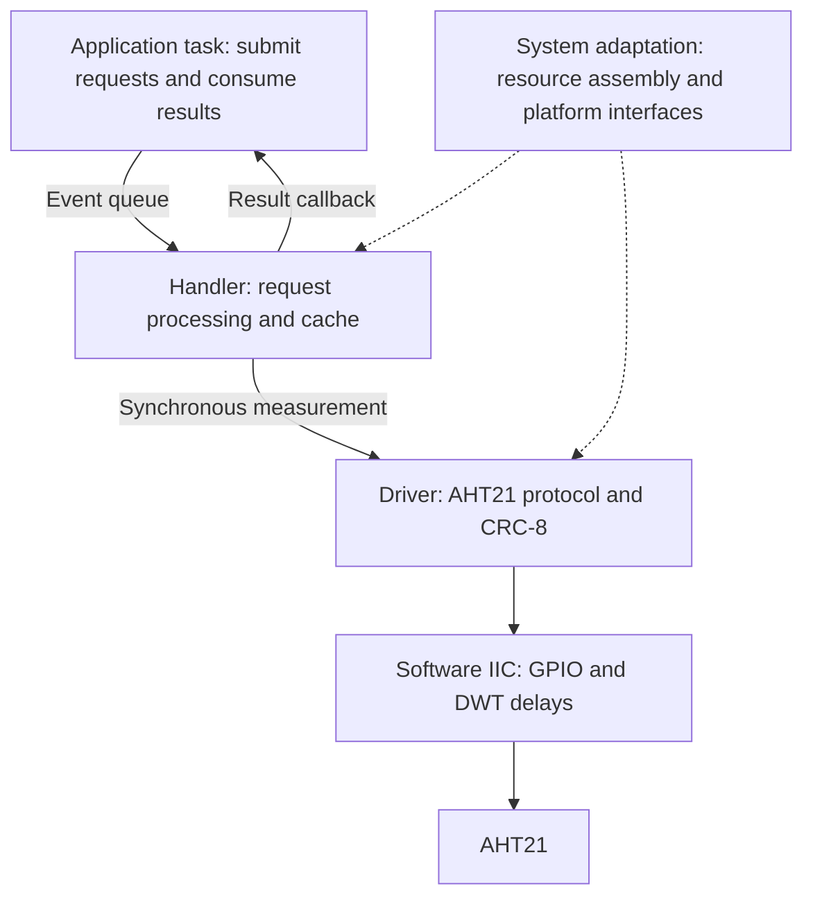

| Layer | Responsibilities | Entry point |
| --- | --- | --- |
| Application task | Provide board configuration, create the Handler worker, submit requests, and handle callbacks | [aht21_task.c](Z03_Business/AHT21_Task/aht21_task.c) |
| System adaptation | Own static objects and interface tables, wrap FreeRTOS queue operations, and assemble and initialize the Handler | [system_adaption.c](Z03_Business/System_Adaption/system_adaption.c) |
| Handler | Receive queued requests, decide whether cached readings need refreshing, and deliver readings through callbacks | [sw_bsp_aht21_handler.c](Z02_BSP/AHT21/sw_bsp_aht21_handler/Src/sw_bsp_aht21_handler.c) |
| Driver | Initialize the sensor, trigger and wait for measurements, verify frames, and convert data to °C and %RH | [sw_bsp_aht21_driver.c](Z02_BSP/AHT21/sw_bsp_aht21_driver/Src/sw_bsp_aht21_driver.c) |
| Bus and time base | Generate GPIO software I²C signals and provide DWT-based microsecond delays | [iic.c](Z02_BSP/IIC/iic.c), [delay.c](Z01_SYS/delay.c) |

Platform dependencies are assembled through interface tables: the GPIO bus descriptor, millisecond time base, RTOS delay, critical sections, and queue operations are supplied to the appropriate layers. The current adaptation still uses STM32 HAL and FreeRTOS. Porting requires adapting these dependencies and reviewing the conditional compilation settings.

## Build and run

The current project uses Keil MDK 5 and ARM Compiler 5. The compiler version recorded in the project is 5.06 update 7.

| AHT21 signal | Board connection |
| --- | --- |
| SDA | PB13 |
| SCL | PB14 |
| GND | Common ground with the board |

Power the sensor module according to its requirements, ensure compatible logic levels, and secure the connections. The AHT21 uses the 7-bit I²C address `0x38`.

1. Open [STM32F411CEU6.uvprojx](MDK-ARM/STM32F411CEU6.uvprojx), select the `STM32F411CEU6` target, and build.
2. Flash through SWD, connect a J-Link, and view EasyLogger output on RTT Viewer **channel 0**.
3. Reset and run. Confirm `AHT21 initialized at IIC address 0x38.` and `AHT21_Instantiate result=0`, then observe request, cache, and callback logs.

During startup, `main.c` initializes the clock, DWT delays, GPIO, and other board resources. [OS_Init()](Z03_Business/Init/os_init.c) creates the status task and AHT21 application task. After the scheduler starts, the application task calls `System_AHT21ResourcesInit()` to initialize the queue and Driver. Only after successful initialization does it create the Handler worker and begin submitting requests.

| Example parameter | Current configuration |
| --- | --- |
| FreeRTOS tick frequency | 1000 Hz |
| Measurement request interval | A 2-second delay after each submission |
| Cache freshness threshold, `lifetime` | 10000 ms |
| Handler queue capacity | 10 events |
| Status task | Toggle the LED and log a message approximately every 5 seconds |

## Understand flow and dependency graphs

These 10 graphs are numbered in the recommended reading order. Original images are stored in [Docs/image](Docs/image); open an image to zoom in. Start with the lifecycle, follow the application, resource assembly, worker, and sensor calls, then review file dependencies.

**Graph 01** is rendered by a custom Understand graph plugin. Its Chinese descriptions, thread groups, and loop edges were manually organized against the source: blue regions show preparation performed once on thread entry; green regions and thick green return edges show recurring loops. **Graphs 02–07** are native Understand call graphs, and **graphs 08–10** show header inclusion. Call graphs describe static relationships rather than thread execution order. For function-pointer nodes, consult graph 01 and the resource assembly code to confirm the bound implementation.

### 01 · System lifecycle

Follow `main()` through board initialization, task creation, and scheduler startup into the application, Handler worker, and status threads. The graph connects measurement, cache reuse, and callback logging while separating one-time thread preparation from recurring `for (;;)` work.

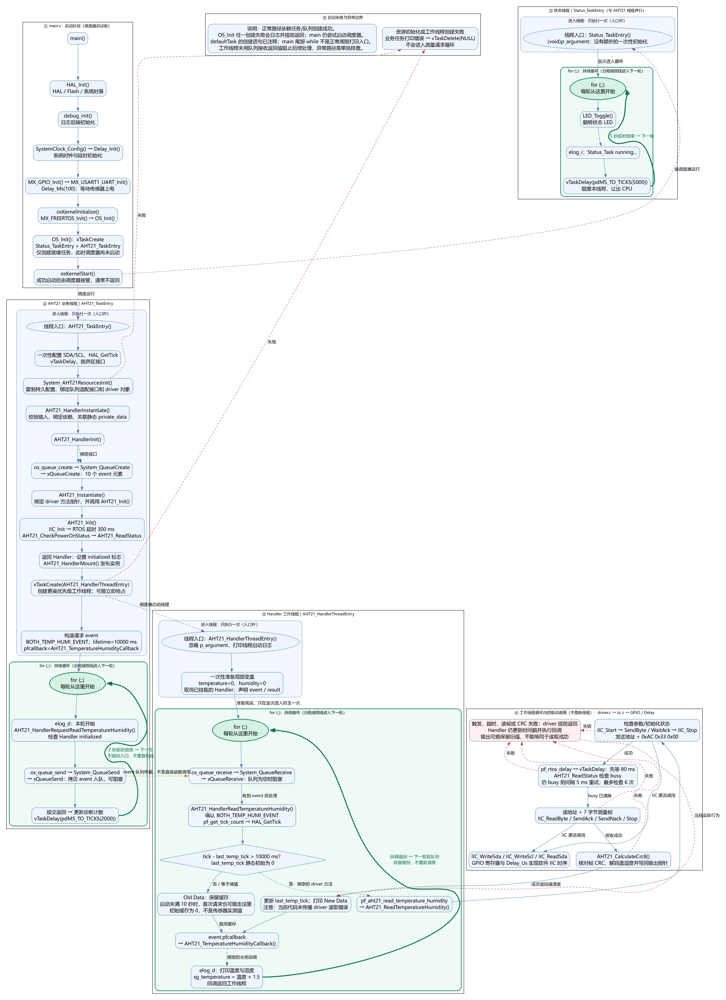

### 02 · Application entry: AHT21_TaskEntry

Trace resource initialization, Handler worker creation, callback binding, and periodic queued requests. Use the lifecycle graph to distinguish startup preparation from the submission loop.

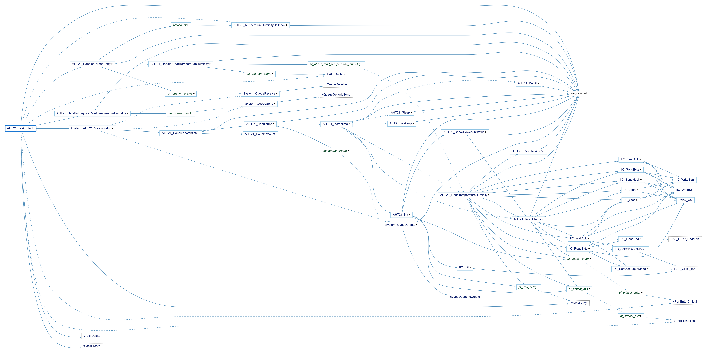

### 03 · Resource assembly: System_AHT21ResourcesInit

Follow platform interface assembly, Handler construction, queue creation, and Driver initialization to see how application configuration reaches the sensor and IIC layers.

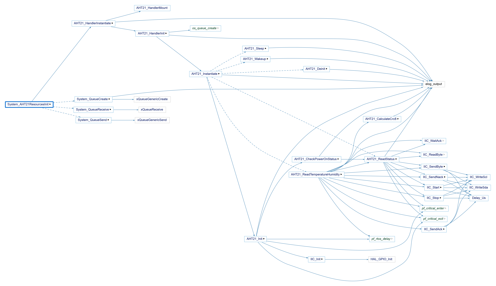

### 04 · Worker: AHT21_HandlerThreadEntry

Focus on receiving queue events, deciding whether to refresh cached readings, and invoking the result callback. Function pointers such as `os_queue_receive`, `pfcallback`, and the Driver method connect the layers.

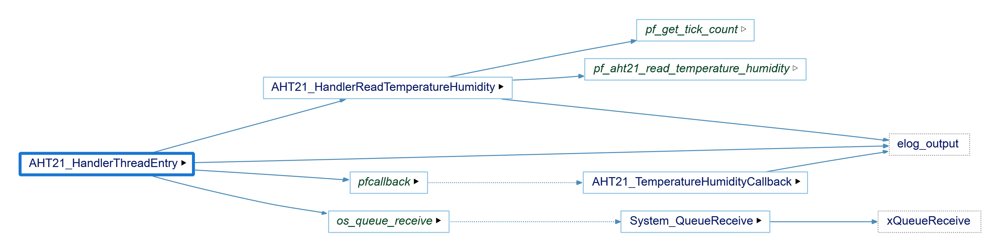

### 05 · Sensor measurement: AHT21_ReadTemperatureHumidity

Inspect measurement commands, status queries, waits, frame reads, and CRC validation, then follow the calls down to GPIO and timing functions.

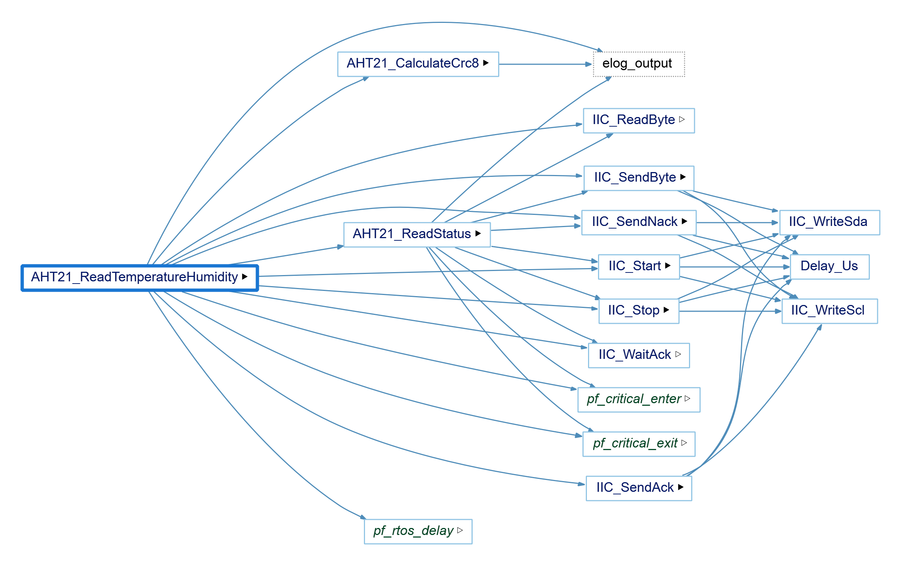

### 06 · System task creation: OS_Init

Review creation of the status and AHT21 application tasks. Task creation and scheduled execution are separate stages; use graph 01 for startup and loop behavior.

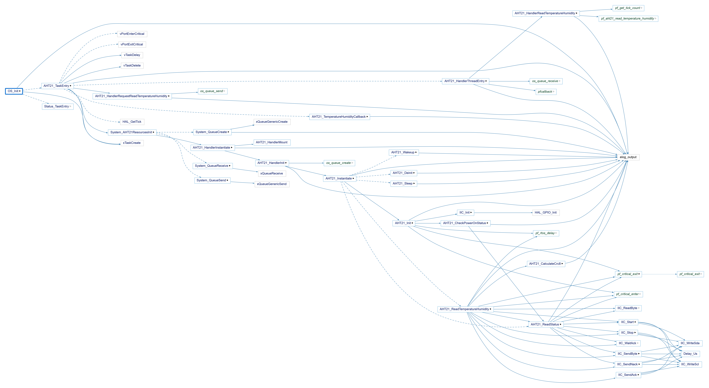

### 07 · IIC register reads: IIC_ReadRegBytes

Trace software IIC start, send, acknowledgment, byte-read, and stop primitives down to SDA/SCL operations and microsecond delays.

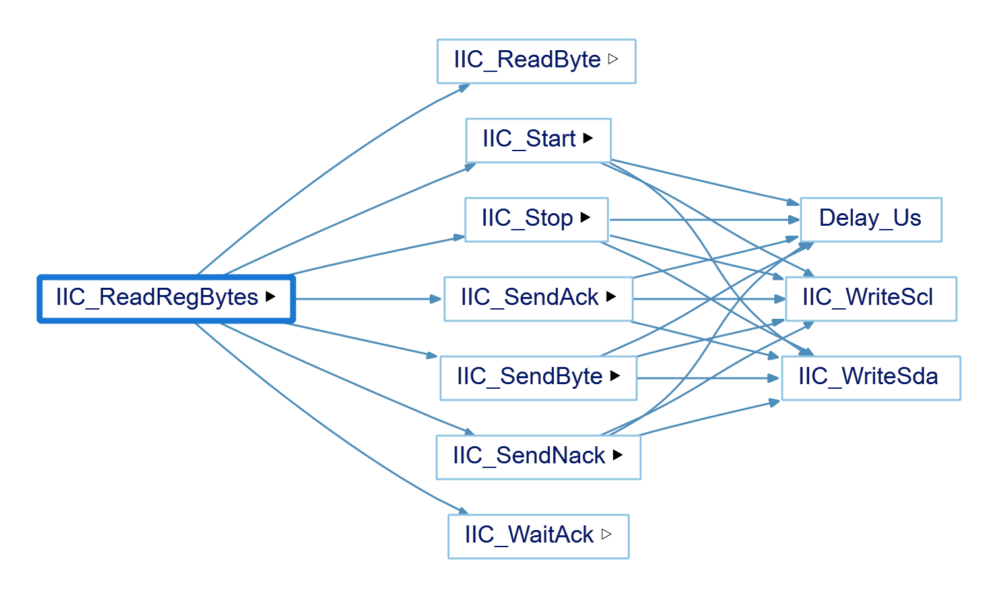

### 08 · Application dependencies: aht21_task.c

Review system adaptation, Handler, Driver, IIC, and RTOS headers to establish a file-by-file reading path from the application layer downward.

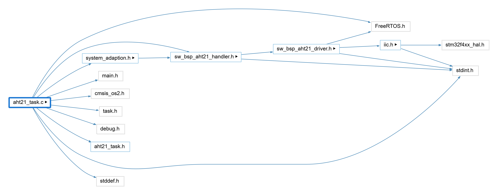

### 09 · Handler dependencies: sw_bsp_aht21_handler.c

Review the Handler implementation's own interface, Driver interface, and related headers to locate request, event, and interface structure declarations.

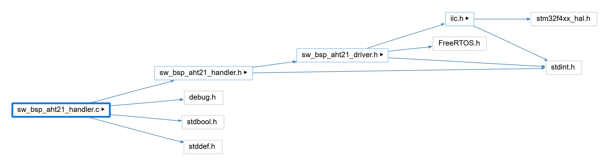

### 10 · Adaptation dependencies: system_adaption.c

Review the headers connecting system adaptation to the Handler, Driver, and platform dependencies. Pair this with graph 03 to locate resource and function-pointer assembly.

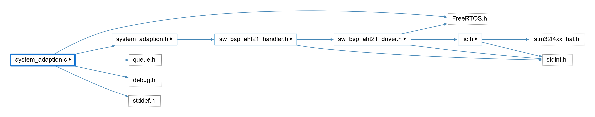

## Interfaces and request example

| Interface | Purpose |
| --- | --- |
| `AHT21_Instantiate()` | Bind Driver platform interfaces and initialize the sensor |
| `AHT21_HandlerInstantiate()` | Bind Handler dependencies, create the queue, and initialize the Driver; does not create a thread |
| `AHT21_HandlerThreadEntry()` | Handler worker thread entry point |
| `AHT21_HandlerRequestReadTemperatureHumidity()` | Copy a measurement event into the queue and return submission status |
| `System_AHT21ResourcesInit()` | Assemble resources for this project; called by the application task before creating the worker |

Declarations are in the [Driver header](Z02_BSP/AHT21/sw_bsp_aht21_driver/Inc/sw_bsp_aht21_driver.h), [Handler header](Z02_BSP/AHT21/sw_bsp_aht21_handler/Inc/sw_bsp_aht21_handler.h), and [system adaptation header](Z03_Business/System_Adaption/system_adaption.h).

After resource initialization and worker startup, submit a request from task context:

```c
#include "debug.h"
#include "sw_bsp_aht21_handler.h"

static void App_OnMeasurement(float *p_temperature, float *p_humidity)
{
    elog_i("aht21.app", "T=%.2f C, RH=%.2f %%",
           (double)*p_temperature, (double)*p_humidity);
}

temp_humi_status_t App_RequestMeasurement(void)
{
    temp_humi_event_t event =
    {
        .lifetime   =               10000U,
        .type       = BOTH_TEMP_HUMI_EVENT,
        .pfcallback =    App_OnMeasurement,
    };

    return AHT21_HandlerRequestReadTemperatureHumidity(&event);
}
```

`TEMP_HUMI_OK` means the request was queued; the worker delivers readings later through the callback. Submission may wait for queue space. Callback pointers refer to readings stored inside the worker. Copy the values if they must be retained; do not retain these pointers.

## Runtime behavior and verification

`lifetime` is the cache freshness threshold in milliseconds. When a request arrives, the Handler attempts a new measurement only if the time since the previous read attempt is **strictly greater than** this threshold. Otherwise, it reuses cached values. A request every 2 seconds therefore does not imply a sensor measurement every 2 seconds: refresh timing depends on both the threshold and request arrival times.

The following excerpt is from a hardware run, with timestamps, paths, and other fields omitted:

```text
AHT21 initialized at IIC address 0x38.
AHT21_Instantiate result=0
New Data
callback:temperature=19.927979, humidity=98.651123
Old Data
callback:temperature=19.927979, humidity=98.651123
```

Integration logs demonstrate sensor initialization, queue sends and receives, the first nonzero readings, cache reuse, 2-second requests, and 5-second status output. Actual readings depend on the environment; these values do not constitute accuracy calibration or long-term stability testing. The example callback logs the readings before multiplying the temperature by `1.5f` for storage in a demonstration variable. That calculation is not sensor calibration.

## Scope and usage notes

- The implemented and hardware-tested flow uses software I²C and FreeRTOS with one sensor and one mounted Handler. Driver initialization state and Handler mounting state use module-level storage, so they cannot be treated as independent multiple instances without changes.
- The Handler currently processes only `BOTH_TEMP_HUMI_EVENT`. Temperature-only and humidity-only events are not implemented. Event output pointers and the `timestamp` field are unused; results are delivered through `pfcallback`.
- Readings and previous-read timestamps start at zero, and the first request does not force a measurement. Before the refresh condition is met, callbacks may receive initial `0.0f` cache values. These are not valid measured zeros.
- The Driver checks communication status and CRC, but the Handler currently does not check queue receive results or propagate measurement failures. It also updates timestamps after read attempts. Consequently, `New Data` indicates a read attempt and is not sufficient evidence of measurement success by itself.
- Resource initialization is intended for a single startup. Complete teardown and resource rollback after initialization failure are not implemented. Driver deinitialization, sleep, and wakeup are reserved implementations. The hardware I²C and bare-metal waiting branches have not been tested on hardware in this project.

## Archive validation

This archive preserves the original learning stage and run records. This pass checks source, project references, documentation links, and retained inputs only. It does not rebuild, flash, or test hardware; hardware results described here belong to the imported project history.

## License

This project is licensed under the **MIT License**. Copyright (c) 2026 JesMicro. See the [LICENSE](LICENSE) file in the project root for the full license text. Third-party components are subject to their respective licenses.
