**简体中文** | [English](README.md)

[](LICENSE)

# AHT21 分层解耦驱动

面向 AHT21 温湿度传感器的嵌入式 C 驱动与应用集成示例。项目通过结构体、函数指针和依赖注入，将传感器协议、测量请求处理、平台资源适配与业务任务分层组织，便于理解驱动设计、替换平台接口和复用测量流程。

仓库提供 **STM32F411CEU6 + GPIO 软件 I²C + FreeRTOS** 的完整集成工程，已完成初始化、队列请求、温湿度读取、回调交付及缓存复用的实机联调。Driver 负责测量命令、状态检查、CRC-8 校验和物理量换算；Handler 负责接收请求、管理缓存并在工作线程中交付结果。

## 分层设计

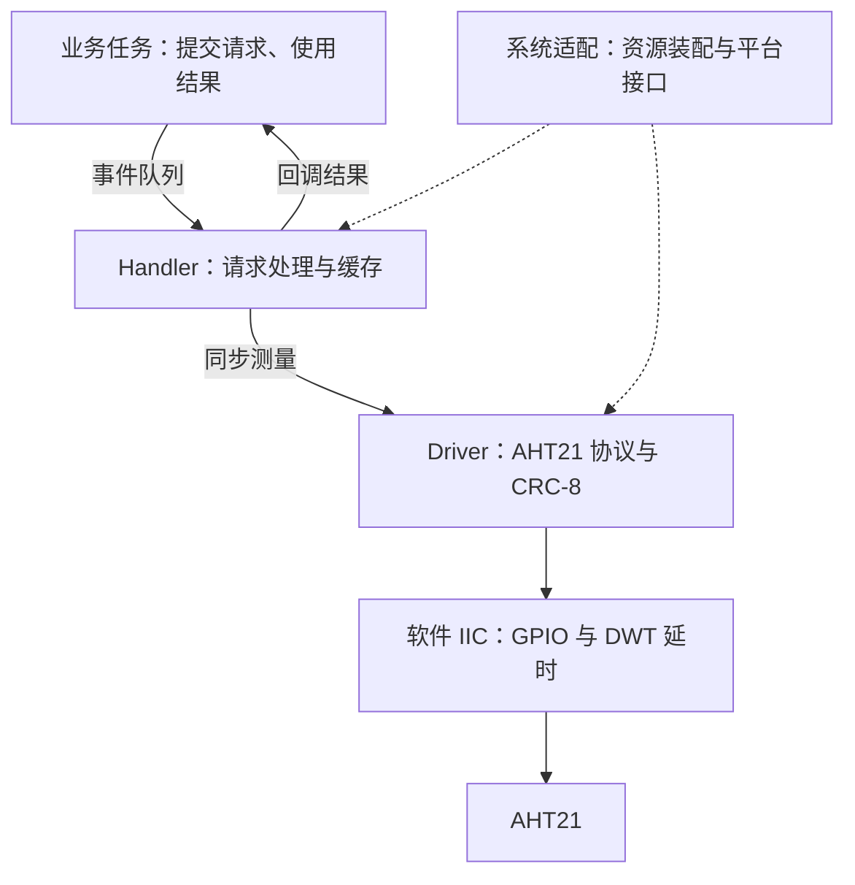

| 层次 | 主要职责 | 代码入口 |
| --- | --- | --- |
| 业务任务 | 提供板级配置、创建 Handler 工作线程、提交请求并处理回调 | [aht21_task.c](Z03_Business/AHT21_Task/aht21_task.c) |
| 系统适配 | 持有静态对象与接口表，封装 FreeRTOS 队列操作，装配并初始化 Handler | [system_adaption.c](Z03_Business/System_Adaption/system_adaption.c) |
| Handler | 从队列接收请求，按缓存新鲜度决定是否读取，通过回调交付温湿度 | [sw_bsp_aht21_handler.c](Z02_BSP/AHT21/sw_bsp_aht21_handler/Src/sw_bsp_aht21_handler.c) |
| Driver | 初始化传感器、触发与等待测量、校验数据帧、换算 °C 和 %RH | [sw_bsp_aht21_driver.c](Z02_BSP/AHT21/sw_bsp_aht21_driver/Src/sw_bsp_aht21_driver.c) |
| 总线与时基 | GPIO 软件 I²C 信号与基于 DWT 的微秒延时 | [iic.c](Z02_BSP/IIC/iic.c)、[delay.c](Z01_SYS/delay.c) |

平台相关依赖集中通过接口表装配：GPIO 总线描述、毫秒时基、RTOS 延时、临界区和队列操作分别传入相应层。当前适配仍使用 STM32 HAL 和 FreeRTOS；移植时需要对接这些依赖，并检查条件编译设置。

## 编译与运行

当前工程使用 Keil MDK 5 和 ARM Compiler 5，工程记录的编译器版本为 5.06 update 7。

| AHT21 信号 | 开发板连接 |
| --- | --- |
| SDA | PB13 |
| SCL | PB14 |
| GND | 与开发板共地 |

按所用传感器模块要求供电，确认通信电平与开发板兼容、接线牢靠。AHT21 的 7 位 I²C 地址为 `0x38`。

1. 打开 [STM32F411CEU6.uvprojx](MDK-ARM/STM32F411CEU6.uvprojx)，选择 `STM32F411CEU6` 目标并编译。
2. 通过 SWD 下载程序，连接 J-Link，在 RTT Viewer **通道 0** 查看 EasyLogger 输出。
3. 复位运行，确认出现 `AHT21 initialized at IIC address 0x38.` 和 `AHT21_Instantiate result=0`，随后观察请求、缓存与回调日志。

启动时，`main.c` 完成时钟、DWT 延时与 GPIO 等基础初始化；[OS_Init()](Z03_Business/Init/os_init.c) 创建状态任务和 AHT21 业务任务。调度器启动后，业务任务调用 `System_AHT21ResourcesInit()` 初始化队列和 Driver，成功后再创建 Handler 工作线程并提交请求。

| 示例参数 | 当前配置 |
| --- | --- |
| FreeRTOS tick 频率 | 1000 Hz |
| 测量请求间隔 | 每次提交后延时 2 秒 |
| 缓存新鲜度阈值 `lifetime` | 10000 ms |
| Handler 队列容量 | 10 个事件 |
| 状态任务 | 约每 5 秒翻转一次 LED 并打印日志 |

## Understand 流程与依赖图

以下 10 张图按建议阅读顺序编号，原图保存在 [Docs/image](Docs/image)。先看总流程，再沿业务入口、资源构造、工作线程和底层读取向下追踪，最后查看文件依赖。点击图片可打开原图并放大查看。

**图 01** 由自定义 Understand 图插件生成，中文说明、线程分区与循环回线依据源码人工整理；蓝色区域表示线程首次进入时的一次性准备，绿色区域和粗绿回线表示后续持续循环。**图 02–07** 为 Understand 原生函数调用图，**图 08–10** 为头文件包含关系图。调用图表示静态关系，不表示线程运行的时间顺序；遇到函数指针节点时，可结合图 01 和资源装配代码继续确认实际绑定目标。

### 01 · 系统总流程

从 `main()` 的基础初始化、任务创建和调度器启动开始，串起业务线程、Handler 工作线程、状态线程，以及测量、缓存、回调打印的完整主线。重点区分线程入口只执行一次的部分和 `for (;;)` 循环部分。

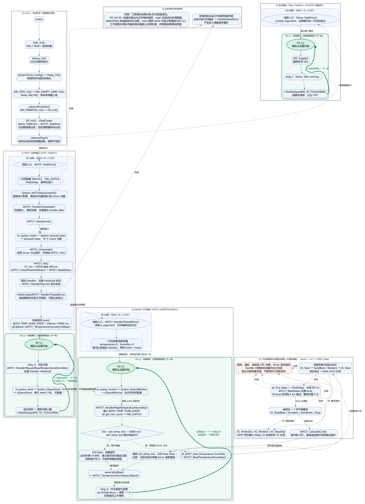

### 02 · 业务任务入口：AHT21_TaskEntry

查看业务任务如何初始化资源、创建 Handler 工作线程、绑定结果回调，再通过队列周期性提交测量请求；配合总流程图理解一次性准备与循环提交的边界。

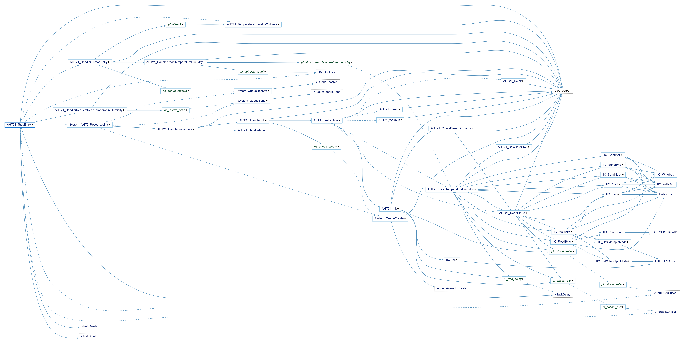

### 03 · 资源装配：System_AHT21ResourcesInit

追踪系统适配层如何装配平台接口、构造 Handler、创建队列并初始化 Driver，理解业务层配置怎样传递到传感器和 IIC 层。

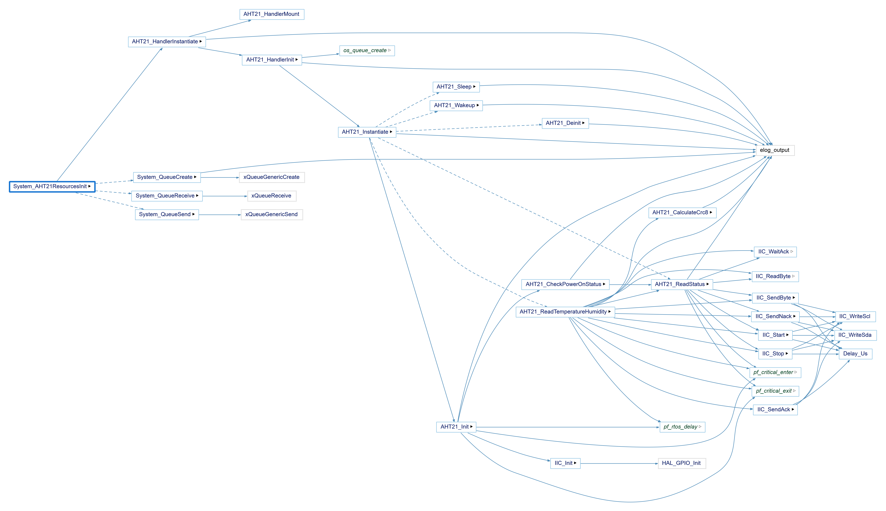

### 04 · 工作线程：AHT21_HandlerThreadEntry

关注“接收队列事件 → 判断是否刷新缓存 → 调用结果回调”的处理主线。图中的 `os_queue_receive`、`pfcallback` 和 Driver 方法通过函数指针连接各层。

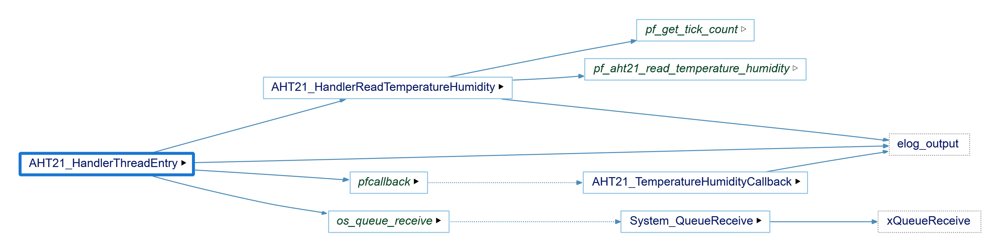

### 05 · 传感器读取：AHT21_ReadTemperatureHumidity

查看一次真实测量涉及的 IIC 命令、状态查询、延时等待、数据帧读取与 CRC 校验，并沿调用关系定位到底层 GPIO 和时序函数。

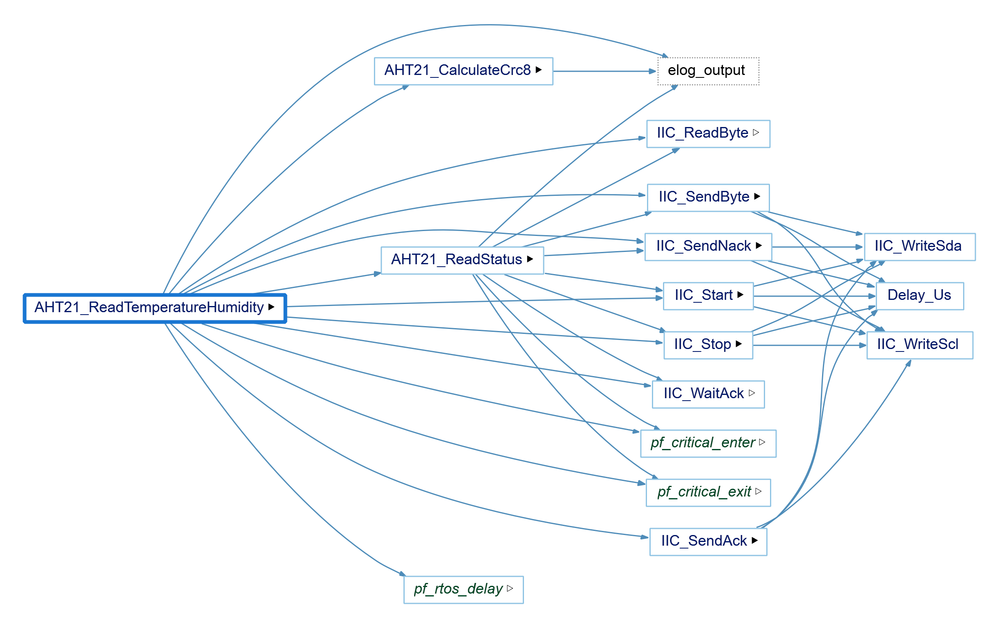

### 06 · 系统任务创建：OS_Init

从系统初始化入口查看状态任务与 AHT21 业务任务的创建关系。任务创建和调度执行是两个阶段，启动先后与循环行为应结合图 01 阅读。

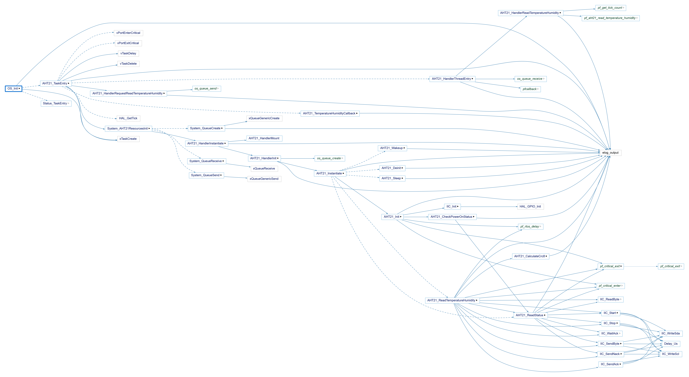

### 07 · IIC 寄存器读取：IIC_ReadRegBytes

聚焦软件 IIC 的寄存器读取，查看起始、发送、应答、读字节、停止等原语怎样落到 SDA/SCL 操作和微秒延时。

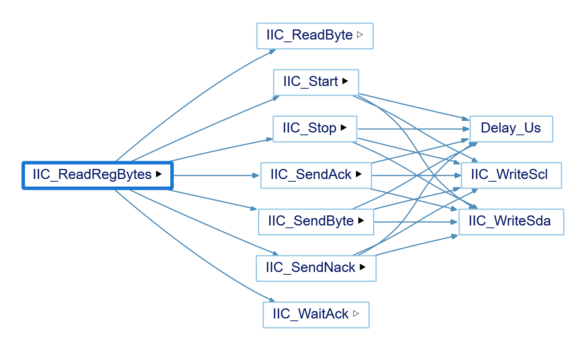

### 08 · 业务文件依赖：aht21_task.c

查看业务任务使用的系统适配、Handler、Driver、IIC 及 RTOS 头文件，建立从应用层向下阅读源码的文件路径。

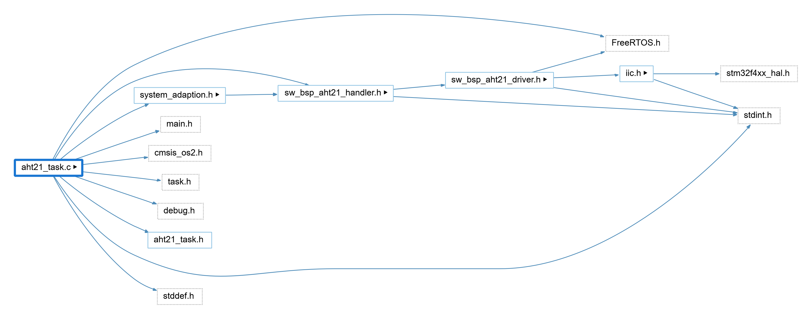

### 09 · Handler 文件依赖：sw_bsp_aht21_handler.c

查看 Handler 实现与自身接口、Driver 接口及相关头文件的包含关系，用于定位请求、事件和接口结构体的声明。

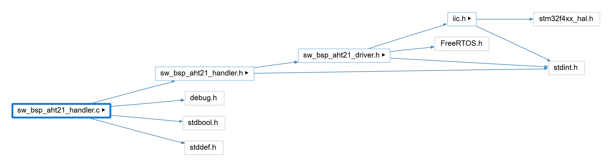

### 10 · 系统适配文件依赖：system_adaption.c

查看系统适配层连接 Handler、Driver 与平台依赖的头文件关系，配合图 03 理解资源和函数指针的装配位置。

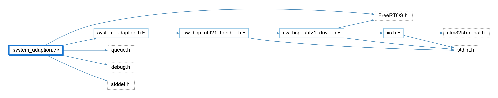

## 接口与请求示例

| 接口 | 用途 |
| --- | --- |
| `AHT21_Instantiate()` | 绑定 Driver 平台接口并初始化传感器 |
| `AHT21_HandlerInstantiate()` | 绑定 Handler 依赖、创建队列并初始化 Driver；不创建线程 |
| `AHT21_HandlerThreadEntry()` | Handler 工作线程入口 |
| `AHT21_HandlerRequestReadTemperatureHumidity()` | 将测量事件复制到队列，返回请求提交状态 |
| `System_AHT21ResourcesInit()` | 当前工程的资源装配入口，供业务任务在创建工作线程前调用 |

接口声明见 [Driver 头文件](Z02_BSP/AHT21/sw_bsp_aht21_driver/Inc/sw_bsp_aht21_driver.h)、[Handler 头文件](Z02_BSP/AHT21/sw_bsp_aht21_handler/Inc/sw_bsp_aht21_handler.h) 和 [系统适配头文件](Z03_Business/System_Adaption/system_adaption.h)。

完成资源初始化并启动工作线程后，可在任务上下文中提交请求：

```c
#include "debug.h"
#include "sw_bsp_aht21_handler.h"

static void App_OnMeasurement(float *p_temperature, float *p_humidity)
{
    elog_i("aht21.app", "T=%.2f C, RH=%.2f %%",
           (double)*p_temperature, (double)*p_humidity);
}

temp_humi_status_t App_RequestMeasurement(void)
{
    temp_humi_event_t event =
    {
        .lifetime   =               10000U,
        .type       = BOTH_TEMP_HUMI_EVENT,
        .pfcallback =    App_OnMeasurement,
    };

    return AHT21_HandlerRequestReadTemperatureHumidity(&event);
}
```

返回 `TEMP_HUMI_OK` 表示请求已入队，测量结果随后由工作线程回调交付。提交操作可能等待队列空间。回调收到的是工作线程内部读数的地址，需要长期保存结果时应复制数值，不要保留这些指针。

## 运行行为与验证

`lifetime` 表示读数的缓存新鲜度阈值，单位为毫秒。收到请求时，只有距上次读取尝试的时间**严格大于**该阈值，Handler 才会尝试更新测量；否则复用缓存。因此，2 秒一次的请求不代表每 2 秒都访问传感器，刷新时刻由阈值和请求到达时间共同决定。

以下为实机输出节选，省略时间、路径等字段：

```text
AHT21 initialized at IIC address 0x38.
AHT21_Instantiate result=0
New Data
callback:temperature=19.927979, humidity=98.651123
Old Data
callback:temperature=19.927979, humidity=98.651123
```

联调日志已验证传感器初始化、队列发送与接收、首次非零读数、缓存复用，以及 2 秒请求和 5 秒状态输出。温湿度数值取决于实际环境，上述读数不作为精度标定或长期稳定性验证结果。示例回调先打印读数，再将温度乘以 `1.5f` 存入演示变量；该计算不属于传感器校准。

## 使用范围与约定

- 当前完成并验证的是软件 I²C + FreeRTOS 下的单个传感器、单个挂载 Handler 流程。Driver 初始化状态和 Handler 挂载状态使用模块级存储，不能直接按独立多实例使用。
- Handler 当前只处理 `BOTH_TEMP_HUMI_EVENT`。单独温度和单独湿度事件尚未实现；事件中的输出指针和 `timestamp` 字段当前未使用，结果通过 `pfcallback` 交付。
- 启动时读数和上次读取时间均为零，首次请求不会强制采样。达到刷新条件前，回调可能收到 `0.0f` 缓存初值，这不表示已经测得有效的零值。
- Driver 会检查通信状态和 CRC，但 Handler 当前未检查队列接收结果，也未传播测量失败；读取尝试后仍更新时间戳。因此 `New Data` 表示执行了读取尝试，不能单独作为测量成功凭据。
- 资源初始化按一次性启动使用，尚无完整的销毁与初始化失败资源回退流程。Driver 的反初始化、休眠和唤醒接口为预留实现；硬件 I²C 和裸机等待分支未纳入本工程的实机验证。

## 归档验证说明

本文保留原工程的学习阶段与既有运行记录。本次归档仅核对代码、工程引用、文档链接和保留文件，未重新编译、烧录或进行硬件测试；文中的实机结果属于导入工程的历史记录。

## 许可证

本项目采用 **MIT License** 开源许可证。Copyright (c) 2026 JesMicro。完整条款请参阅根目录的 [LICENSE](LICENSE) 文件。第三方组件遵循各自的许可证。
